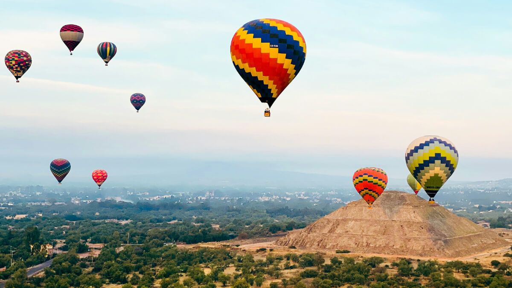
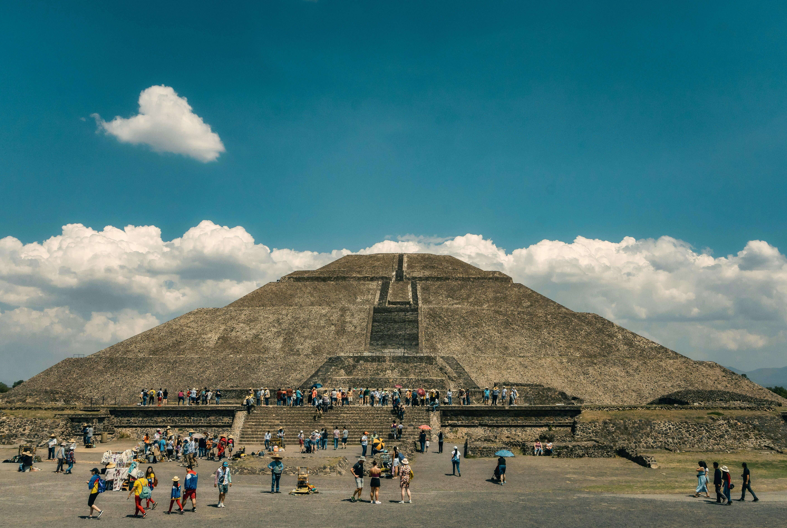

## Hot Air Balloon Experience in Teotihuacán &nbsp;

### Introduction
Experience the magic of one of Mexico's most extraordinary archaeological sites from a completely different perspective with a hot air balloon flight over the ancient city of Teotihuacán. As the first light of day illuminates the surrounding valley, gently rise above the landscape and admire breathtaking panoramic views of the impressive Pyramid of the Sun, the Pyramid of the Moon, and the Avenue of the Dead. Floating peacefully above this UNESCO World Heritage Site, surrounded by mountains and the vast Mexican countryside, offers a truly unforgettable way to appreciate the scale and beauty of this ancient civilisation. Whether celebrating a special occasion or simply looking for a unique experience during your visit to Mexico City, a sunrise balloon flight over Teotihuacán is an exceptional adventure.

### The Experience
The experience typically begins early in the morning, when guests arrive at the launch site to watch the balloons being prepared and inflated. After a safety briefing from the professional flight crew, take off as the sun begins to rise over the Teotihuacán Valley. During the flight, enjoy spectacular aerial views of the archaeological complex, including its monumental pyramids, ancient ceremonial avenues, and surrounding countryside. The duration of the flight is generally around 45 to 60 minutes, depending on weather conditions. Following the landing, celebrate the experience with a traditional toast and breakfast before continuing the day with an optional visit to the archaeological site itself.

### Why We Recommend This Experience
A unique perspective – Admire the extraordinary archaeological landscape of Teotihuacán from above, with views impossible to experience from the ground. &nbsp;  
&nbsp;  
A spectacular sunrise – Watch the first rays of sunlight illuminate the ancient pyramids and surrounding valley. &nbsp;  
&nbsp;  
An unforgettable adventure – Enjoy the peaceful sensation of floating above one of Mexico's most remarkable historical destinations. &nbsp;  
&nbsp;  
A memorable photo opportunity – Capture breathtaking panoramic views of the Pyramid of the Sun, Pyramid of the Moon, and the surrounding landscape. &nbsp;  
&nbsp;  
A perfect combination of adventure and culture – Combine the balloon flight with a visit to the archaeological site for a deeper appreciation of Teotihuacán's fascinating history. &nbsp;  

### Practical Information
Hot air balloon flights generally take place at sunrise, with early morning departures depending on the season and weather conditions. The experience is weather-dependent, and flights may be postponed or cancelled if conditions are unsuitable. Comfortable clothing, closed-toe shoes, and an additional layer for the cooler early morning temperatures are recommended. Advance reservations are essential.