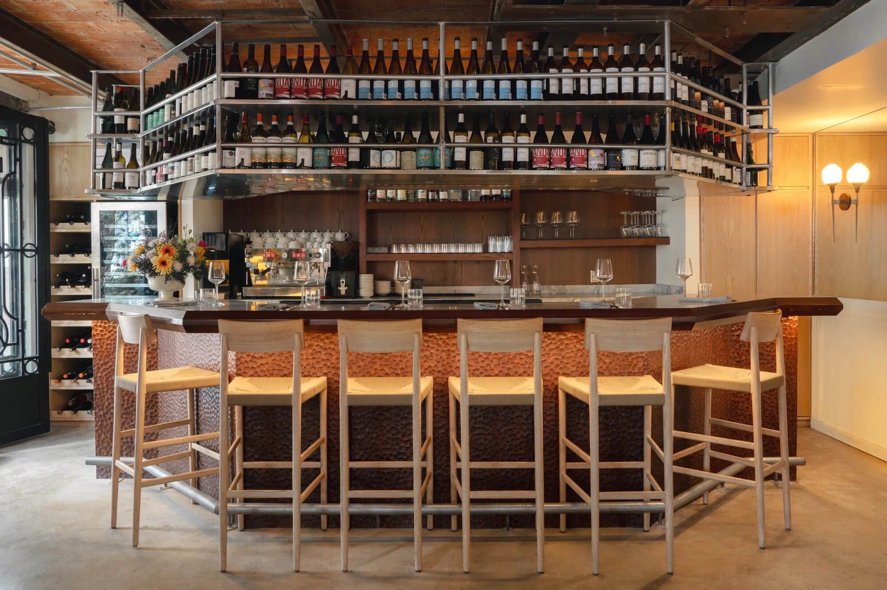
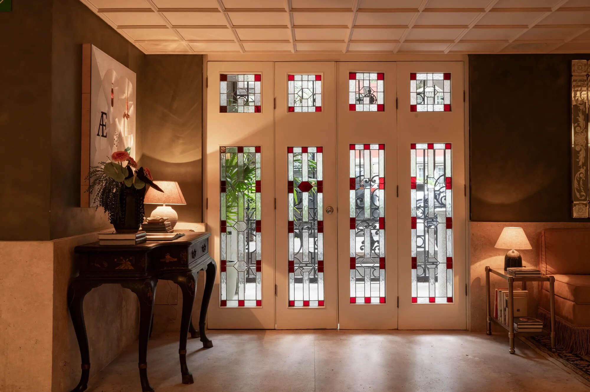
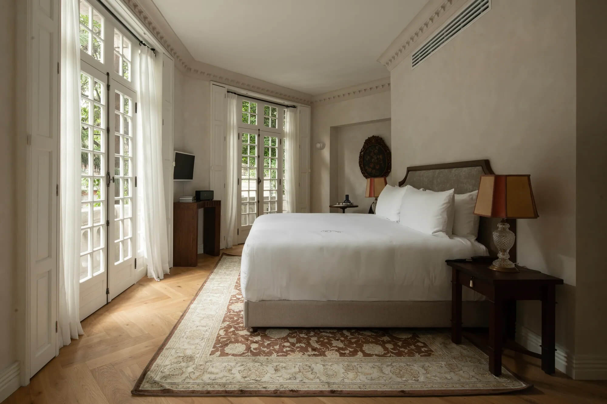

## El Cortés Mexico City &nbsp;

### Introduction
Tucked away in a quiet corner of Roma Norte, El Cortés is an intimate luxury boutique hotel housed within a beautifully restored French-inspired mansion dating back to 1915. Once a presidential residence, the historic property has been carefully revived through a meticulous restoration involving artisans, architects, and designers, preserving its architectural heritage while introducing contemporary elegance. Antique furnishings, original details, curated artwork, and thoughtfully designed interiors create an atmosphere that feels more like an elegant private residence than a conventional hotel. As a member of Relais & Châteaux, El Cortés celebrates authentic hospitality, local culture, and distinctive experiences. With its intimate setting, discreet service, and quietly romantic character, it offers a refined retreat in one of Mexico City's most desirable neighbourhoods.

### Location
Located on Colima Street in Roma Norte, El Cortés enjoys a privileged position in one of Mexico City's most vibrant and culturally layered districts. The neighbourhood is known for its elegant historic architecture, tree-lined avenues, independent boutiques, contemporary art galleries, and exceptional culinary scene. Guests can explore the surrounding streets on foot, discovering charming cafés, design studios, and some of the city's most celebrated restaurants. Nearby Condesa offers beautiful parks and further opportunities for leisurely walks, while the cultural attractions of Chapultepec, Polanco, and the historic city centre are easily accessible by car. The hotel's location provides an excellent balance between the energy of the capital and the privacy of a peaceful residential setting.

### What to Do
Discover Roma Norte at a leisurely pace, exploring its architectural heritage, independent galleries, vintage boutiques, and lively café culture. Take a walk towards Plaza Río de Janeiro or continue into neighbouring Condesa to enjoy its leafy streets and beautiful parks. Art and culture enthusiasts can visit the museums and galleries throughout the city, including the Museo Nacional de Antropología, Museo de Arte Moderno, and the historic centre's architectural landmarks. Food lovers will find plenty to discover in the surrounding neighbourhood, from contemporary Mexican restaurants to international culinary destinations. Back at the hotel, enjoy the peaceful atmosphere of the restored mansion and experience the gastronomic offering at Lotti, where European culinary traditions meet Mexican ingredients. The concierge can also assist with arranging personalised experiences and discovering the city's cultural and gastronomic highlights.

### Why We Recommend This Hotel
A historic private residence – Housed in a beautiful French-inspired mansion dating back to 1915, the hotel offers a distinctive sense of heritage and architectural character. &nbsp;  
&nbsp;  
Relais & Châteaux hospitality – As a member of this prestigious association, El Cortés embraces personalised service, authenticity, and a strong connection to local culture. &nbsp;  
&nbsp;  
An intimate boutique experience – Its discreet residential atmosphere creates a peaceful and personal retreat within one of Mexico City's most vibrant neighbourhoods. &nbsp;  
&nbsp;  
Elegant, individually styled rooms – Antique furnishings, historic details, contemporary comforts, and carefully curated amenities create accommodation with a timeless sense of style. &nbsp;  
&nbsp;  
A distinctive culinary experience – Lotti brings together European culinary traditions and Mexican ingredients through the personal vision of Swiss-born chef Luc Liebster. &nbsp;  
&nbsp;  
A prime Roma Norte location – Surrounded by art galleries, boutiques, cafés, and celebrated restaurants, the hotel is ideally positioned for discovering the city's creative side. &nbsp;  
&nbsp;  
A peaceful urban hideaway – The combination of historic architecture, a quiet residential setting, and personalised hospitality makes El Cortés an appealing escape from the energy of the capital. &nbsp;  

### Dining Options
Lotti is the hotel's intimate restaurant, offering a thoughtful interpretation of European classics through the personal culinary vision of Swiss-born chef Luc Liebster. The menu brings together European techniques and traditions with Mexican ingredients and flavours, creating a culinary experience inspired by memory, personal history, and a sense of place. Rather than following a conventional fine-dining format, Lotti offers a neighbourhood restaurant atmosphere with a generous and carefully considered approach to cuisine. It provides an inviting setting for breakfast and other dining experiences, while its location in Roma Norte places guests within easy reach of some of Mexico City's most exciting restaurants, cafés, and cocktail bars.

<iframe src="https://www.google.com/maps/embed?pb=!1m18!1m12!1m3!1d3762.837890017747!2d-99.16541328892217!3d19.419409041025922!2m3!1f0!2f0!3f0!3m2!1i1024!2i768!4f13.1!3m3!1m2!1s0x85d1ff39faa07473%3A0xcc3f3970ca6124fc!2sEl%20Cortes!5e0!3m2!1sen!2sde!4v1795356494166!5m2!1sen!2sde" width="800" height="450" style="border:0;" allowfullscreen="" loading="lazy" referrerpolicy="strict-origin-when-cross-origin"></iframe>