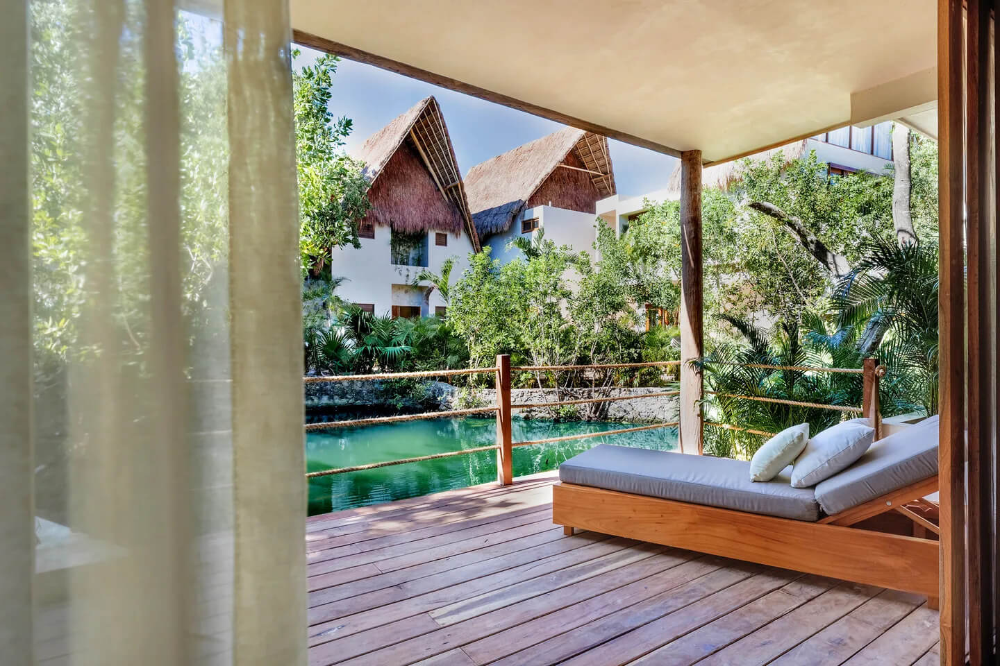
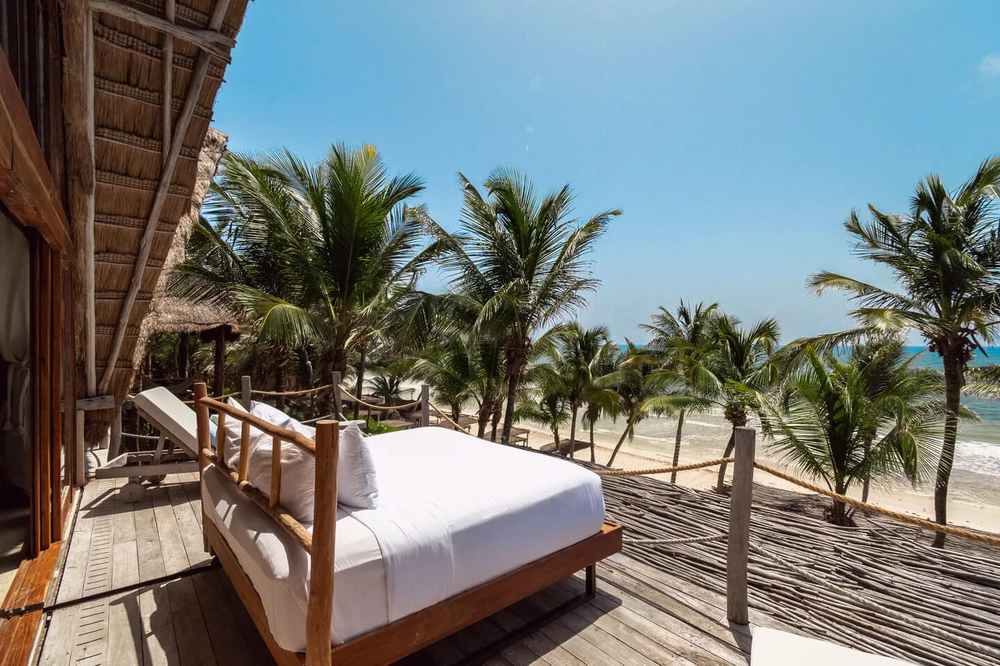
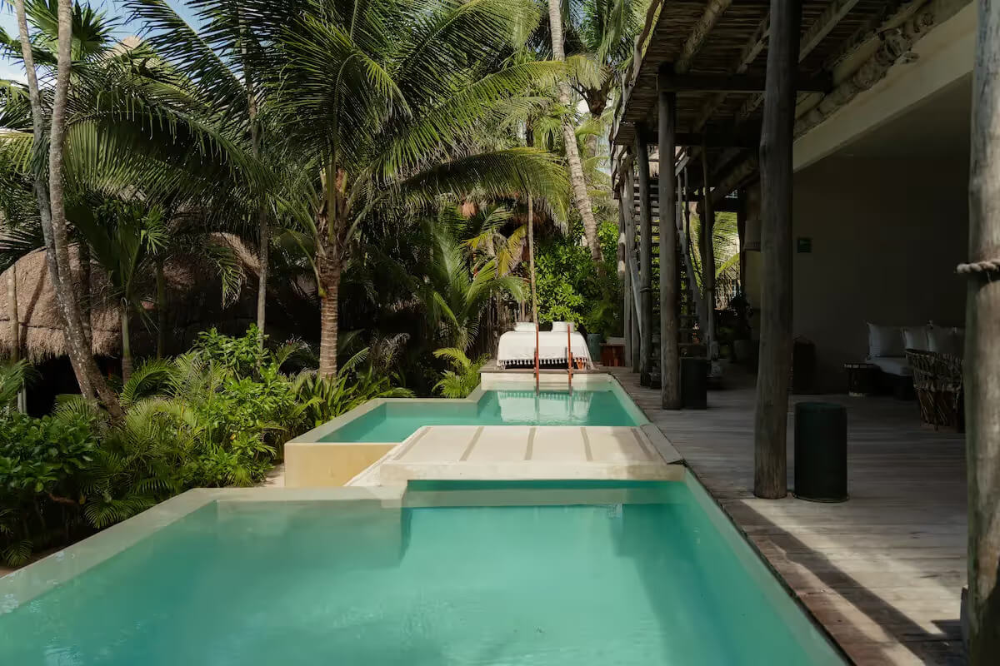
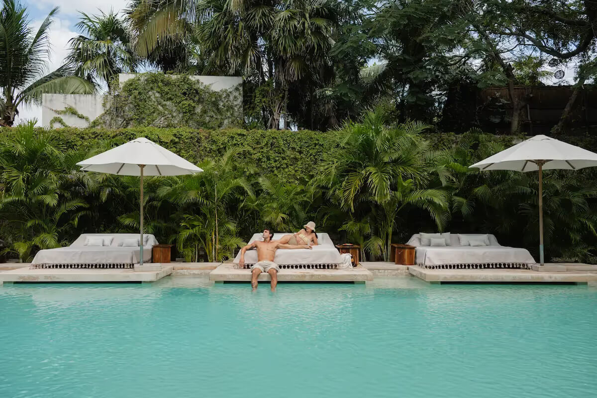
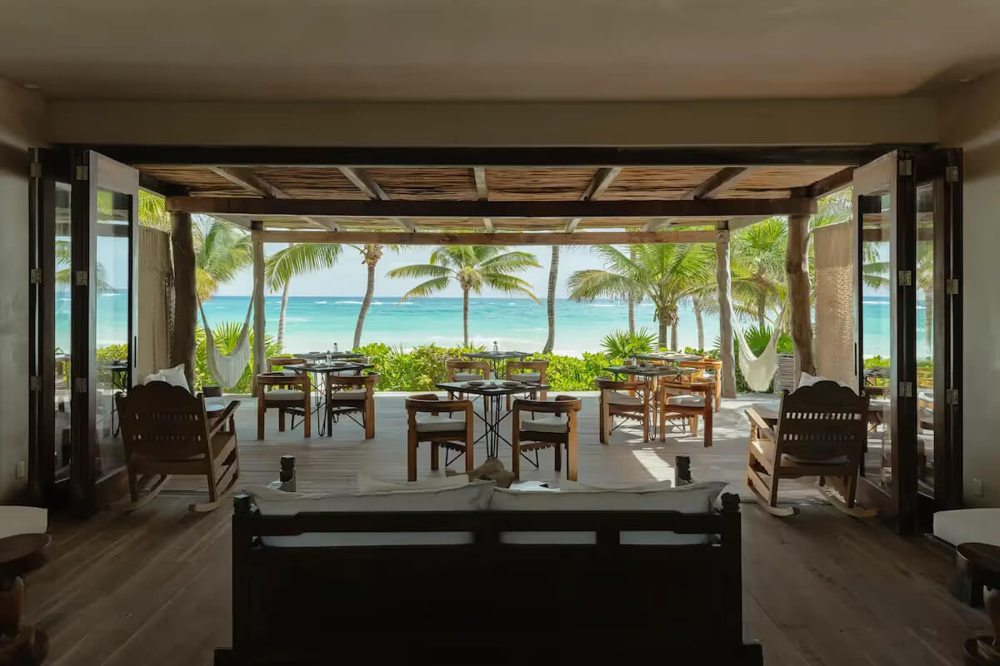

## La Valise Tulum &nbsp;

### Introduction
Where the lush Mayan jungle meets the turquoise waters of the Caribbean Sea, La Valise Tulum offers an intimate luxury hideaway designed around nature, privacy, and understated sophistication. Located along the beautiful southern coastline of Tulum, this distinctive boutique hotel features 22 individually designed suites divided between two settings: eleven directly on the beach and eleven nestled beneath the tropical jungle canopy. Natural materials, handcrafted details, and open-air architecture create a seamless connection between indoor and outdoor living. One of the hotel's most iconic features is its signature rolling beds, allowing guests to move their king-size beds onto their private terraces and sleep beneath the stars. A member of Small Luxury Hotels of the World, La Valise offers a highly personalised experience for travellers seeking a more intimate and meaningful Caribbean escape. The property welcomes guests aged 12 and above.

### Location
Situated at kilometre 8.7 along the Carretera Tulum-Boca Paila, La Valise enjoys a privileged beachfront position in South Tulum, where the tropical jungle meets the Caribbean coastline. Its setting offers a more secluded atmosphere than the busier areas of the destination, while remaining close to Tulum's celebrated restaurants, beach clubs, boutiques, and nightlife. The surrounding area is characterised by pristine beaches, lush vegetation, and the natural beauty of the Riviera Maya. Guests can explore the nearby Tulum archaeological site, discover the region's spectacular cenotes, or venture further into the Yucatán Peninsula to experience its ancient Mayan heritage. The hotel is approximately 90 minutes by road from Cancún International Airport and around 30 miles from Tulum International Airport.

### What to Do
Spend leisurely days enjoying the hotel's private beach, relaxing beside the swimming pools, or discovering the natural cenote hidden within the jungle gardens. The two distinct sides of the property offer different experiences, from the sound of the waves and panoramic Caribbean views to the peaceful atmosphere of the tropical canopy. Guests can enjoy yoga classes, personalised spa treatments, and wellness rituals inspired by ancient Mayan traditions. For a deeper connection with the destination, explore the hotel's Voyage Within programme, which brings together wellness, nature, culture, art, and gastronomy through individually curated experiences. Activities can include cacao ceremonies, sound healing, pottery workshops, meditation, and traditional Mayan rituals. The concierge can also arrange private boat excursions, snorkelling, cenote adventures, and visits to the archaeological sites of Tulum and Cobá. For a more relaxed way to discover the area, bicycles are available for guests to explore the surrounding coastline.

### Why We Recommend This Hotel
An exceptional jungle-meets-beach setting – The property combines two distinctive environments, with eleven suites directly on the Caribbean beach and eleven surrounded by the tropical jungle. &nbsp;  
&nbsp;  
An intimate boutique experience – With just 22 individually designed suites and a minimum guest age of 12, La Valise offers a peaceful and personalised atmosphere. &nbsp;  
&nbsp;  
Signature rolling beds – One of the hotel's most distinctive features, the movable king-size beds allow guests to sleep outdoors on their private terraces beneath the stars. &nbsp;  
&nbsp;  
Private plunge pools – Every suite features its own plunge pool, creating an additional sense of privacy and exclusivity. &nbsp;  
&nbsp;  
A natural cenote within the property – The jungle gardens feature a natural cenote, offering a unique opportunity to connect with the natural environment of the Yucatán Peninsula. &nbsp;  
&nbsp;  
A distinctive wellness philosophy – La Valise Spa, yoga classes, sound healing, cacao ceremonies, and traditional Mayan-inspired rituals create a holistic approach to relaxation and well-being. &nbsp;  
&nbsp;  
Exceptional culinary experiences – From the beachfront and jungle restaurants to the Michelin Guide-recognised NÜ Tulum, the hotel offers a memorable gastronomic experience. &nbsp;  
&nbsp;  
A commitment to sustainability – The property has held Zero Waste certification since 2023 and participates in The Tulum Pledge, supporting more responsible tourism and local community initiatives. &nbsp;  

### Dining Options
La Valise Tulum offers a distinctive culinary experience through two restaurant settings, complemented by the acclaimed NÜ Tulum. The hotel's beachfront and jungle restaurants celebrate Caribbean and traditional Mexican cuisine with a contemporary French influence. Designed around a relaxed tapeo-style concept, dinner is served as a selection of dishes intended to be shared, creating a convivial and informal dining experience. Breakfast is complimentary, while lunch and dinner can be enjoyed by the beach or surrounded by the tropical jungle, with meals also available on guests' private terraces. For a more elevated gastronomic experience, NÜ Tulum, located within the jungle setting, is recognised in the Michelin Guide and showcases contemporary Mexican cuisine using fresh, locally sourced, and sustainable ingredients. Its intimate atmosphere and creative approach to regional flavours make it one of the area's most distinctive dining destinations. Private dining experiences, curated mezcal tastings, and cooking classes can also be arranged for guests seeking something more personalised.

<iframe src="https://www.google.com/maps/embed?pb=!1m18!1m12!1m3!1d3745.846454884652!2d-87.46411793890785!3d20.140452417616757!2m3!1f0!2f0!3f0!3m2!1i1024!2i768!4f13.1!3m3!1m2!1s0x8f4fd993fd74560b%3A0x4b4970328b22db95!2sLa%20Valise%20Tulum%2C%20Member%20of%20Small%20Luxury%20Hotels%20of%20the%20World!5e0!3m2!1sen!2sde!4v1795357069597!5m2!1sen!2sde" width="800" height="450" style="border:0;" allowfullscreen="" loading="lazy" referrerpolicy="strict-origin-when-cross-origin"></iframe>