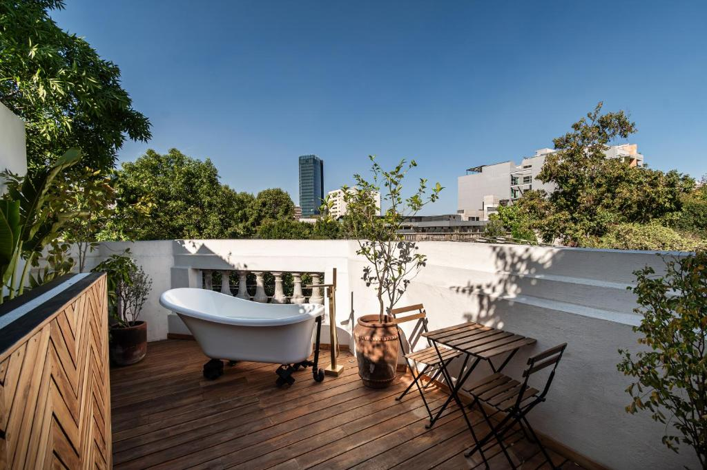
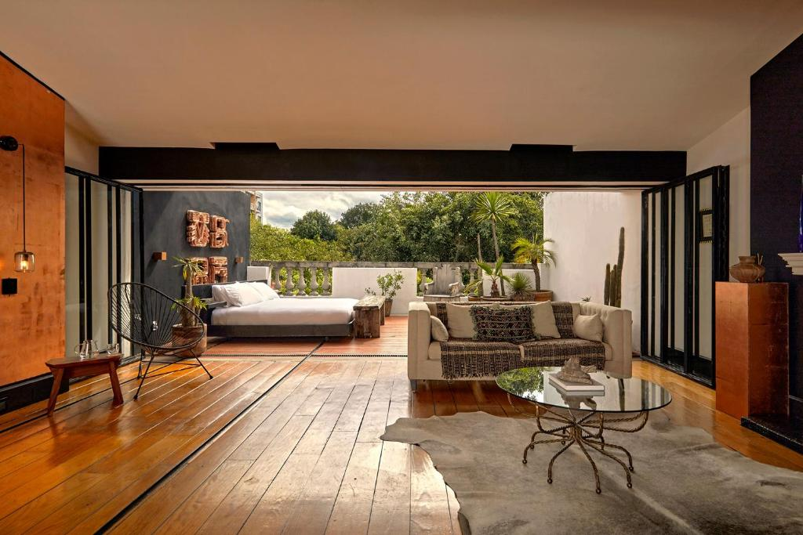
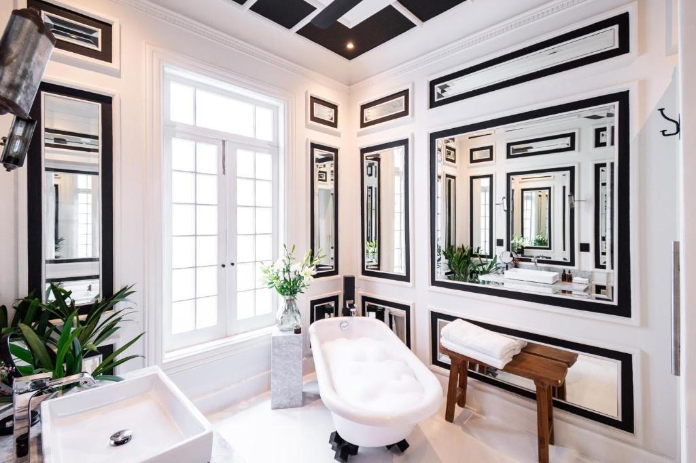
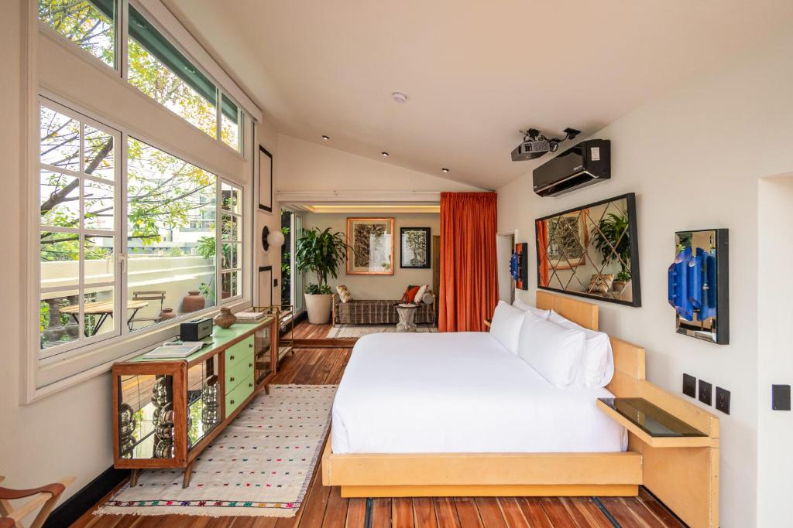

## La Valise Mexico City &nbsp;

<iframe src='https://www.youtube.com/embed/sOBF3DUsdpc' frameborder='0' allowfullscreen></iframe>

### Introduction
Hidden behind the discreet entrance of a beautiful 1920s French-style townhouse in the heart of Roma Norte, La Valise Mexico City is an intimate luxury boutique hotel that offers a distinctive urban retreat. Combining historic architectural details with contemporary design, carefully curated antiques, regional craftsmanship, and one-of-a-kind artworks, the property feels more like an elegant private residence than a conventional hotel. Its eight individually designed suites each have their own personality, featuring bespoke furnishings, thoughtful details, and an atmosphere that celebrates creativity and individuality. A member of Small Luxury Hotels of the World and recognised with one MICHELIN Key in 2024, La Valise is an exceptional choice for travellers seeking a more personal and culturally immersive experience of Mexico City.

### Location
Located on Tonalá Street in the vibrant Roma Norte neighbourhood, La Valise enjoys an excellent position for discovering one of Mexico City's most creative and fashionable districts. The surrounding streets are lined with independent boutiques, art galleries, vintage shops, cafés, and some of the city's most celebrated restaurants. Plaza Río de Janeiro is just a short walk away, while the neighbouring districts of Condesa and Juárez offer further opportunities to explore the city's design, culinary, and cultural scenes. With its tree-lined avenues, historic architecture, and lively atmosphere, Roma Norte provides an ideal setting for experiencing Mexico City beyond its traditional tourist attractions.

### What to Do
Discover Roma Norte on foot, exploring its independent galleries, concept stores, vintage boutiques, and neighbourhood cafés. Take a leisurely walk to Plaza Río de Janeiro before continuing towards the elegant streets of Condesa, known for its parks, architecture, and vibrant restaurant scene. Art and design enthusiasts can explore the city's many museums and galleries, including the Museo Nacional de Antropología, Museo de Arte Moderno, and Museo Soumaya. For a deeper cultural experience, arrange a private city tour to discover Mexico City's historic centre, its architectural landmarks, and its rich artistic heritage. Back at the hotel, enjoy a moment of relaxation with a personalised spa treatment or experience the hotel's unique Pis-cinema, combining an indoor swimming pool with a cinematic experience. The concierge can also curate individual experiences and restaurant recommendations to make the most of your stay.

### Why We Recommend This Hotel
An intimate boutique experience – With just eight individually designed suites, La Valise offers a sense of privacy and personalised hospitality that is increasingly rare in a major capital city. &nbsp;  
&nbsp;  
Historic French-style architecture – Set within a beautifully restored 1920s townhouse, the property retains its original architectural character, including high ceilings, ornate mouldings, and original floor tiles. &nbsp;  
&nbsp;  
Individual suite design – No two suites are alike, with bespoke furnishings, curated artwork, antiques, and distinctive design details creating a unique experience in every room. &nbsp;  
&nbsp;  
A creative neighbourhood setting – Located in Roma Norte, the hotel places guests within walking distance of independent galleries, stylish boutiques, excellent restaurants, and some of the city's most interesting cafés. &nbsp;  
&nbsp;  
A distinctive urban retreat – The combination of its indoor pool and cinema concept, personalised spa treatments, and peaceful atmosphere offers a welcome escape from the energy of Mexico City. &nbsp;  
&nbsp;  
Recognised boutique hospitality – A member of Small Luxury Hotels of the World and recipient of one MICHELIN Key in 2024, La Valise is recognised for its distinctive character and quality of hospitality. &nbsp;  
&nbsp;  
Personalised experiences – A dedicated concierge helps guests discover the destination through curated cultural, gastronomic, and wellness experiences. &nbsp;  

### Dining Options
La Valise Café, located on the ground floor of the townhouse, brings the atmosphere of a French neighbourhood café to the heart of Roma Norte. Serving all-day breakfast and lunch, the café offers freshly prepared dishes, French pastries, speciality coffees, and a selection of signature beverages. Breakfast is included with the stay and can be enjoyed in the café or delivered directly to the suite, allowing guests to start the day at their own pace. While La Valise does not operate a full-service hotel restaurant or bar, its concierge can recommend and arrange experiences at some of the neighbourhood's most celebrated dining establishments. With renowned restaurants, independent cafés, and lively cocktail bars just steps away, guests are perfectly positioned to explore Mexico City's exceptional culinary scene.

<iframe src="https://www.google.com/maps/embed?pb=!1m18!1m12!1m3!1d3762.8452871648046!2d-99.1656381888124!3d19.419089541035458!2m3!1f0!2f0!3f0!3m2!1i1024!2i768!4f13.1!3m3!1m2!1s0x85d1ff39ede04515%3A0xc4c1fd784f73adde!2sLa%20Valise%20mx%20City%2C%20an%20SLH%20Hotel!5e0!3m2!1sen!2sde!4v1794741581940!5m2!1sen!2sde" width="800" height="450" style="border:0;" allowfullscreen="" loading="lazy" referrerpolicy="strict-origin-when-cross-origin"></iframe>