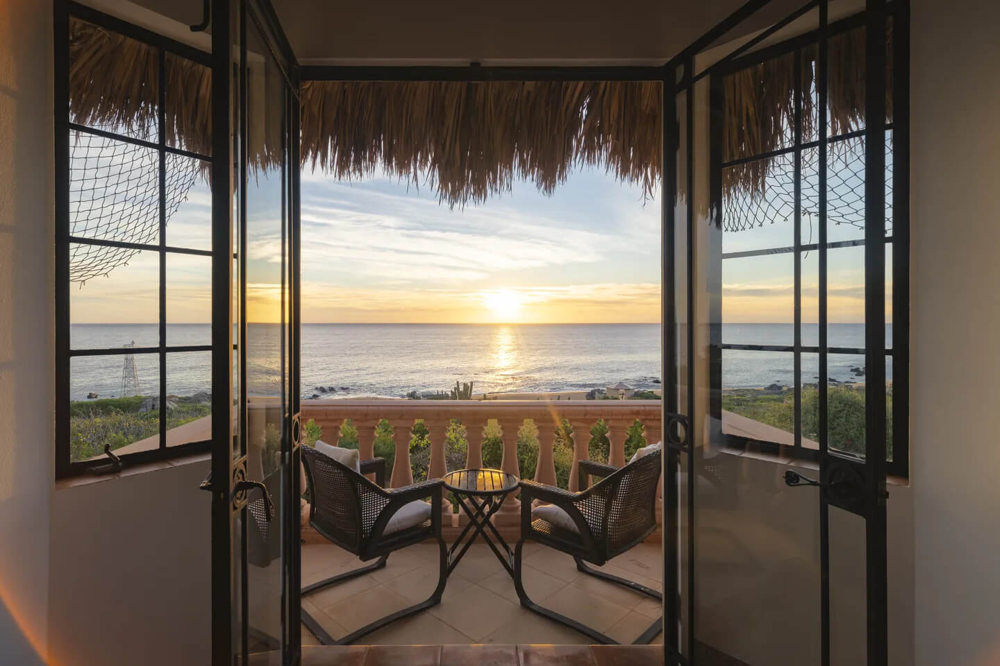
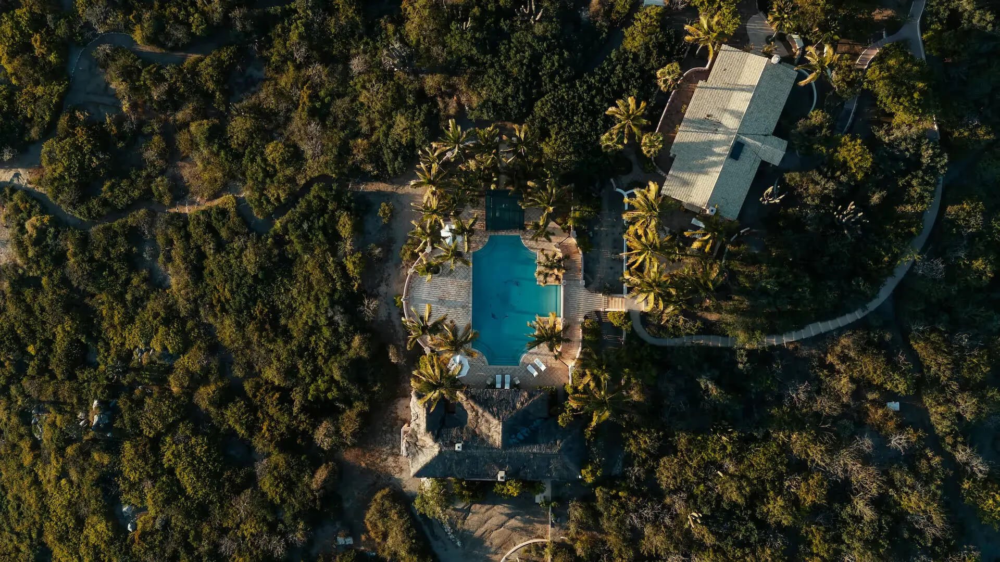
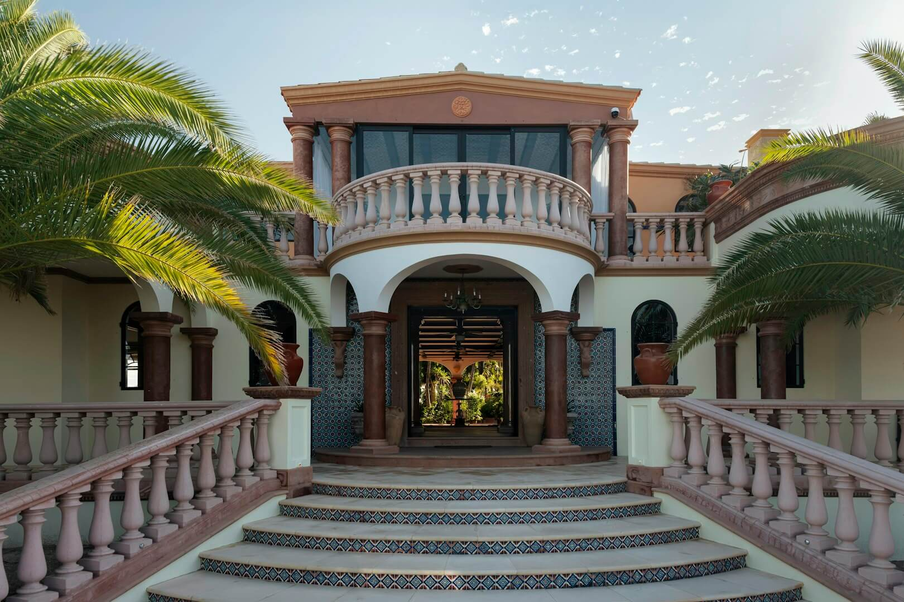
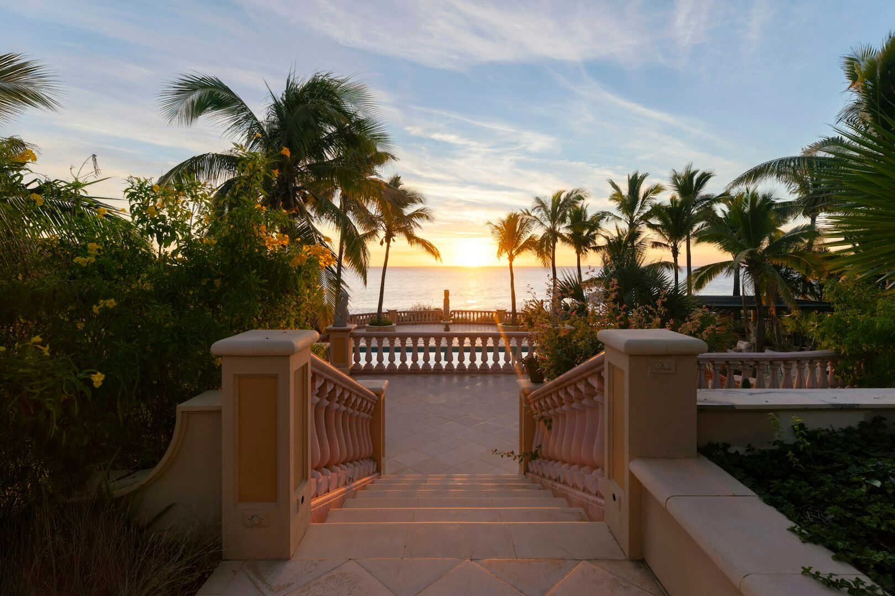
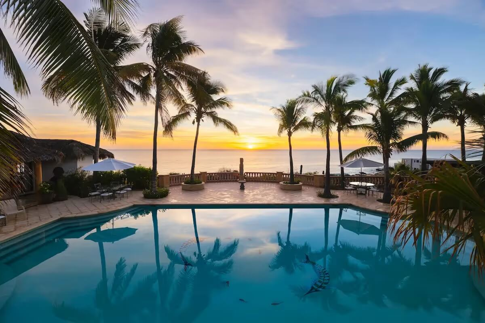

## La Valise Los Cabos &nbsp;

### Introduction
Where the rugged beauty of the Baja California desert meets the crystal-clear waters of the Sea of Cortez, La Valise Los Cabos offers an intimate luxury retreat designed around nature, tranquillity, and understated elegance. Located along the secluded East Cape coastline, this distinctive property features a collection of individually designed Casas, combining the warmth of traditional Mexican haciendas with the refined simplicity of Mediterranean design. Natural materials such as adobe, hand-carved wood, and stone create a harmonious connection between the architecture and its surroundings, while expansive terraces open onto sweeping ocean views and peaceful desert gardens. Designed for travellers aged 12 and above, La Valise offers a more secluded alternative to the traditional Los Cabos resort experience, inviting guests to slow down and reconnect with the natural environment. A member of Small Luxury Hotels of the World, it is an exceptional choice for those seeking privacy, personalised hospitality, and meaningful experiences.

### Location
Situated at Boca de la Vinorama on the East Cape of Baja California Sur, La Valise Los Cabos enjoys a secluded beachfront setting where the desert landscape meets the Sea of Cortez. Located approximately 30 minutes by scenic coastal road from the main Los Cabos resort area, the property feels wonderfully removed from the busier atmosphere of Cabo San Lucas and San José del Cabo. Its surroundings are characterised by unspoiled beaches, dramatic desert scenery, native vegetation, and spectacular ocean views. The region offers access to some of Baja California's most beautiful natural attractions, including Cabo Pulmo National Park, renowned for its protected marine ecosystem and extraordinary underwater biodiversity. The journey from Los Cabos International Airport takes approximately 75 minutes, and the hotel recommends arranging private transportation or renting an SUV to explore the surrounding area.

### What to Do
Enjoy the peaceful rhythm of the East Cape, spending leisurely days beside the swimming pool overlooking the Sea of Cortez or relaxing on the property's secluded beach. Kayaks are available for guests to explore the coastline, while the surrounding waters offer exceptional opportunities for snorkelling, scuba diving, fishing, whale watching, and private boat excursions. Nature enthusiasts can arrange an expedition to Cabo Pulmo National Park, one of Mexico's most remarkable marine reserves, or discover the region through guided surfing and horseback riding experiences. For a more restorative stay, explore The Voyage Within, the hotel's curated experiences programme, which brings together wellness, nature, culture, community, and gastronomy. Activities range from yoga, Tai Chi, sound healing, and meditation to ceramics workshops, Mexican cooking classes, and local wine and spirits tastings. In the evening, enjoy a private dinner beneath the Baja sky or watch the sunset over the ocean, surrounded by the stillness of the desert.

### Why We Recommend This Hotel
A secluded East Cape setting – Located along an unspoiled stretch of Baja California's coastline, the property offers a peaceful alternative to the more developed resort areas of Los Cabos. &nbsp;  
&nbsp;  
Distinctive architectural character – The Casas combine traditional Mexican hacienda inspiration with Mediterranean influences, using adobe, hand-carved wood, and natural stone to create a harmonious connection with the landscape. &nbsp;  
&nbsp;  
Individually designed Casas – Each accommodation has its own character, with private terraces, carefully selected furnishings, and views across the ocean, gardens, or surrounding desert. &nbsp;  
&nbsp;  
A close connection with nature – The beachfront setting, desert gardens, native vegetation, and sweeping Sea of Cortez views create an immersive experience shaped by the natural environment. &nbsp;  
&nbsp;  
Personalised hospitality – A dedicated concierge curates individual experiences, arranges transportation, and helps guests discover the destination at their own pace. &nbsp;  
&nbsp;  
The Voyage Within – A thoughtfully curated programme of wellness, adventure, culture, community, and gastronomy offers opportunities to connect more deeply with Baja California and its traditions. &nbsp;  
&nbsp;  
An intimate adults-and-teens retreat – Welcoming guests aged 12 and above, the property is particularly appealing to couples and families seeking privacy, tranquillity, and a more relaxed style of luxury. &nbsp;  
&nbsp;  
A spectacular natural playground – The surrounding coastline provides access to kayaking, surfing, diving, fishing, whale watching, and the extraordinary marine environment of Cabo Pulmo. &nbsp;  

### Dining Options
La Valise Los Cabos offers a personalised dining experience inspired by the flavours and culinary traditions of Baja California Sur. Rather than following a conventional resort restaurant concept, the property focuses on intimate experiences and tailored dining arrangements. Complimentary breakfast is included, while guests can enjoy meals and refreshments in the privacy of their Casa or on their terraces overlooking the Sea of Cortez. The concierge can arrange a variety of culinary experiences, including Baja-style tacos, Mexican cooking classes, organic salsa and guacamole workshops, and curated Mexican wine, tequila, and mezcal tastings. For a particularly memorable evening, private romantic dinners can be organised in a beautiful setting, with a bespoke menu and personalised atmosphere. This approach allows guests to discover regional flavours in a relaxed and intimate environment, while celebrating the ingredients, wines, and culinary heritage of Baja California.

<iframe src="https://www.google.com/maps/embed?pb=!1m18!1m12!1m3!1d3665.964897213995!2d-109.44127932439868!3d23.244364408014192!2m3!1f0!2f0!3f0!3m2!1i1024!2i768!4f13.1!3m3!1m2!1s0x86a5f30fe3698573%3A0x1220caaa31d7ba2f!2sVilla%20Del%20Faro!5e0!3m2!1sen!2sde!4v1795357873488!5m2!1sen!2sde" width="800" height="450" style="border:0;" allowfullscreen="" loading="lazy" referrerpolicy="strict-origin-when-cross-origin"></iframe>

