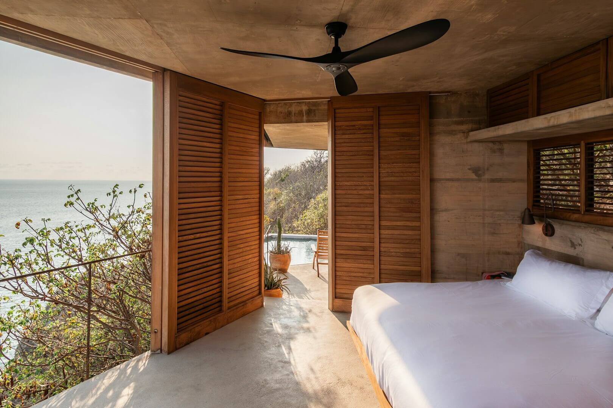
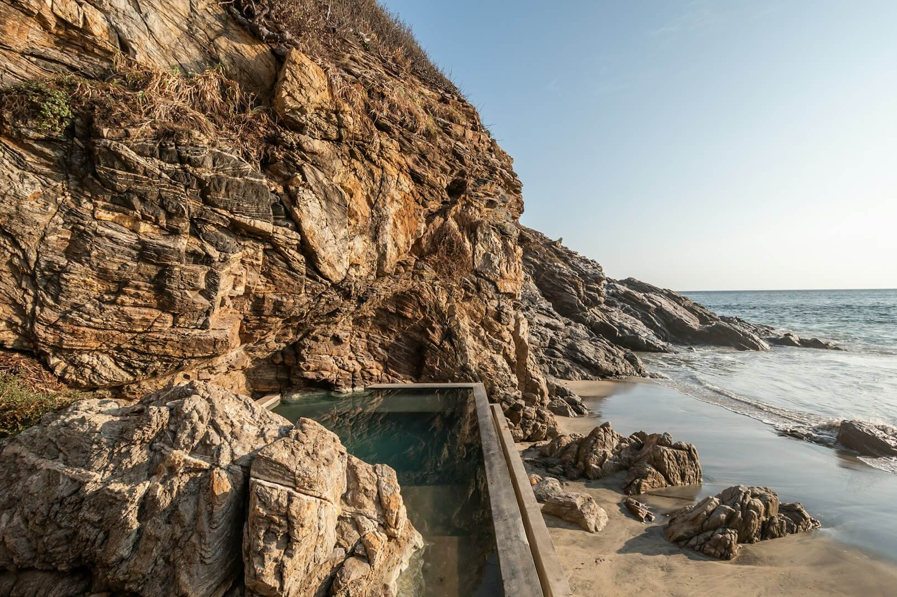
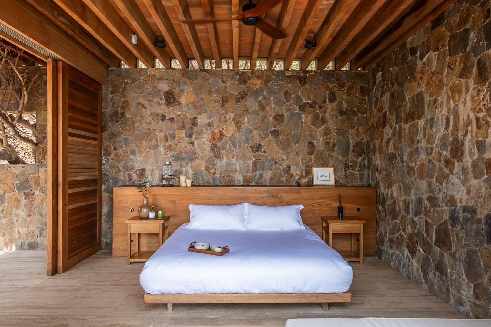
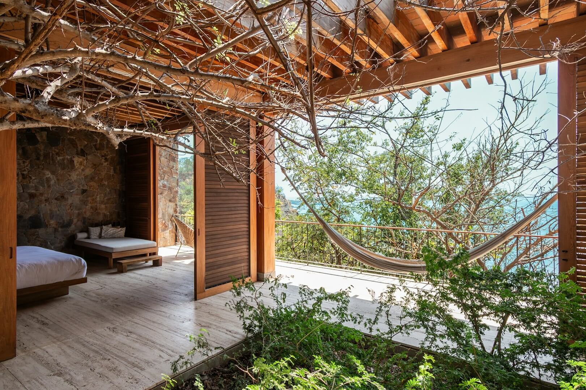

## La Valise Mazunte &nbsp;

### Introduction
Set within a spectacular 30-hectare private coastal reserve on the Pacific coast of Oaxaca, La Valise Mazunte is an intimate luxury retreat where architecture, nature, and understated elegance exist in perfect harmony. Designed by renowned Mexican architects Alberto Kalach and Ignacio Urquiza, the property comprises three distinctive residences housing ten individually designed suites, alongside the iconic Villa Pentágonos, a striking standalone villa perched above the Pacific. Built using locally sourced stone, wood, and natural finishes, the architecture blends seamlessly into the surrounding cliffs and tropical landscape. As a member of Small Luxury Hotels of the World, La Valise offers a secluded and highly personalised experience for travellers seeking privacy, exceptional natural beauty, and a deeper connection with the destination. The property is exclusively for adults aged 18 and above.

### Location
Located within Reserva El Torón, between the coastal villages of Mazunte and San Agustinillo, La Valise enjoys a privileged position above a secluded stretch of Oaxaca's Pacific coastline. Surrounded by protected vegetation, dramatic cliffs, and uninterrupted ocean views, the property offers a peaceful escape from the more developed resort destinations of Mexico. The charming village of Mazunte is just a short drive away, known for its laid-back atmosphere, independent cafés, artisan shops, and beautiful beaches. Nearby San Agustinillo offers a relaxed coastal setting, while Punta Cometa provides one of the region's most spectacular viewpoints for watching the sunset. The hotel is approximately 50 minutes by road from Huatulco International Airport and around one hour from Puerto Escondido, with private transfers available through the concierge.

### What to Do
Spend leisurely days enjoying the infinity pools built directly into the natural rock formations, where the water appears to merge with the endless Pacific horizon. Discover the property's private beach, located within the protected El Torón Reserve, which also serves as an important nesting habitat for sea turtles. During selected seasons, guests may have the opportunity to witness newly hatched turtles making their first journey towards the ocean. Explore the surrounding reserve on guided nature walks, discovering its endemic vegetation, birdlife, and seasonal transformations. For a more active experience, bicycles are available to explore the nearby coastal villages, while the concierge can arrange boat excursions, snorkelling, and other ocean adventures. The hotel's Voyage Within programme offers a collection of curated experiences across wellness, nature, culture, creativity, community, and gastronomy. Guests can also enjoy in-suite massages and facials, allowing for a restorative experience without leaving the privacy of their accommodation.

### Why We Recommend This Hotel
An extraordinary natural setting – Located within a protected 30-hectare coastal reserve, the property offers an immersive experience surrounded by Oaxaca's dramatic cliffs, tropical vegetation, and the Pacific Ocean. &nbsp;  
&nbsp;  
Distinctive architectural design – Conceived by renowned Mexican architects Alberto Kalach and Ignacio Urquiza, the property combines contemporary architecture with locally sourced materials and a thoughtful integration into the natural landscape. &nbsp;  
&nbsp;  
An intimate boutique experience – With ten individually designed suites and one standalone villa, La Valise offers privacy, exclusivity, and highly personalised hospitality. &nbsp;  
&nbsp;  
The iconic Villa Pentágonos – Designed by Alberto Kalach, this remarkable standalone villa features a private infinity pool and spectacular views across the Pacific, creating an exceptional accommodation experience. &nbsp;  
&nbsp;  
Infinity pools carved into the cliffs – The swimming pools are integrated into the natural rock formations, offering a spectacular setting overlooking the ocean. &nbsp;  
&nbsp;  
A private beach and turtle sanctuary – Direct access to a secluded beach within El Torón Reserve provides a unique opportunity to experience the natural environment and seasonal sea turtle nesting activity. &nbsp;  
&nbsp;  
The Voyage Within – A thoughtfully curated programme of wellness, nature, culture, creativity, community, and gastronomy allows guests to connect with the destination through meaningful experiences. &nbsp;  
&nbsp;  
A commitment to responsible luxury – The architecture, locally sourced materials, and protected natural surroundings reflect a philosophy of hospitality that prioritises the preservation of the environment. &nbsp;  
&nbsp;  

### Dining Options
Dining at La Valise Mazunte celebrates the flavours of Oaxaca and the Pacific coast through a personalised culinary experience known as Mazunte Delights. The hotel's house chef creates menus that combine traditional Mexican flavours with international influences, using carefully selected local ingredients to highlight the region's culinary identity. Meals are served in open-air dining spaces and terraces overlooking the Pacific, allowing guests to enjoy the surrounding natural beauty alongside their dining experience. Complimentary breakfast is included with the stay, while lunch and dinner offer opportunities to discover the chef's seasonal creations. The intimate setting and personalised approach make dining an integral part of the experience, whether enjoying a relaxed breakfast overlooking the ocean or a memorable evening meal beneath the coastal sky.

<iframe src="https://www.google.com/maps/embed?pb=!1m18!1m12!1m3!1d3841.6026919969154!2d-96.5729282245436!3d15.666131550102477!2m3!1f0!2f0!3f0!3m2!1i1024!2i768!4f13.1!3m3!1m2!1s0x85b9292eda934747%3A0x42ad01606630416f!2sLa%20Valise%20Mazunte!5e0!3m2!1sen!2sde!4v1795359419093!5m2!1sen!2sde" width="800" height="450" style="border:0;" allowfullscreen="" loading="lazy" referrerpolicy="strict-origin-when-cross-origin"></iframe>
