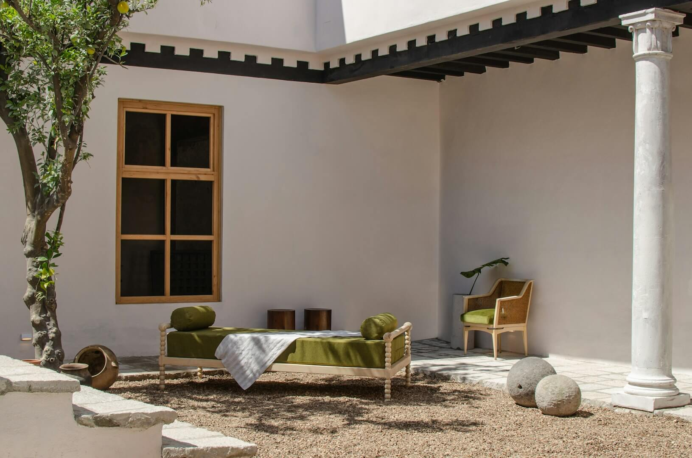
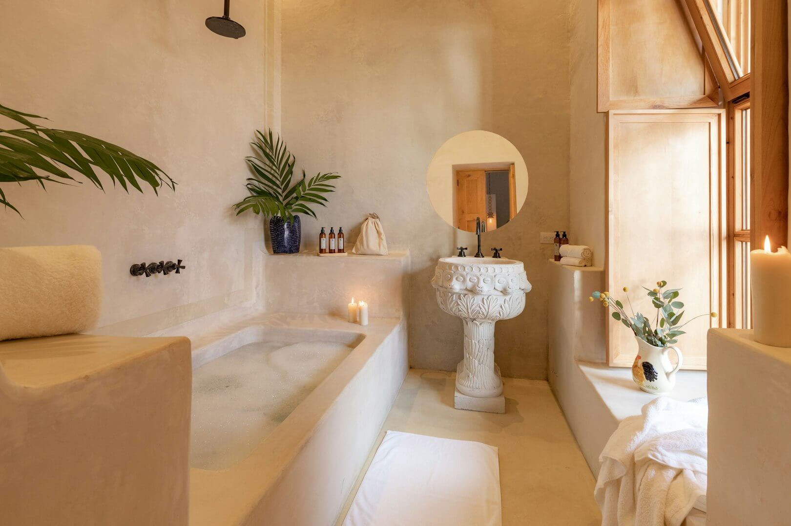
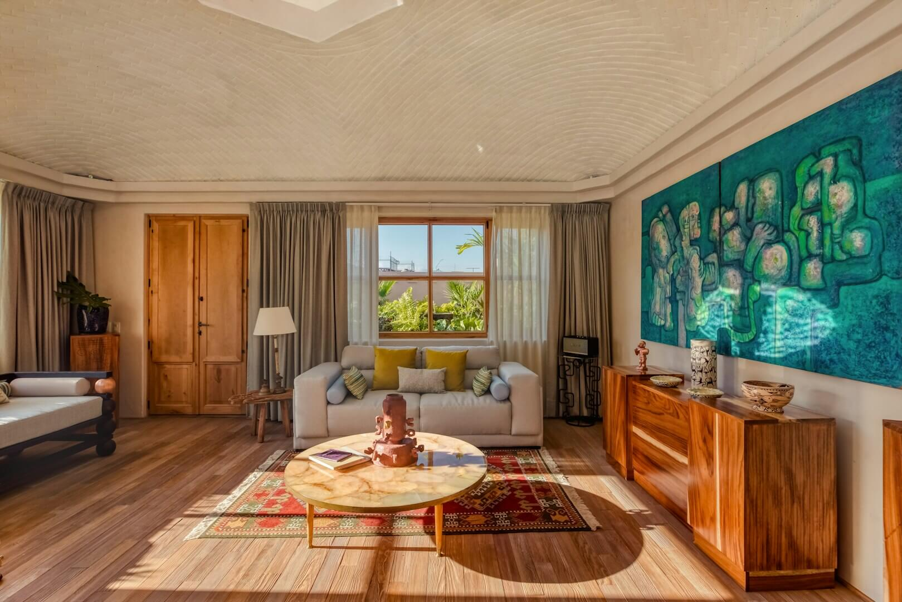
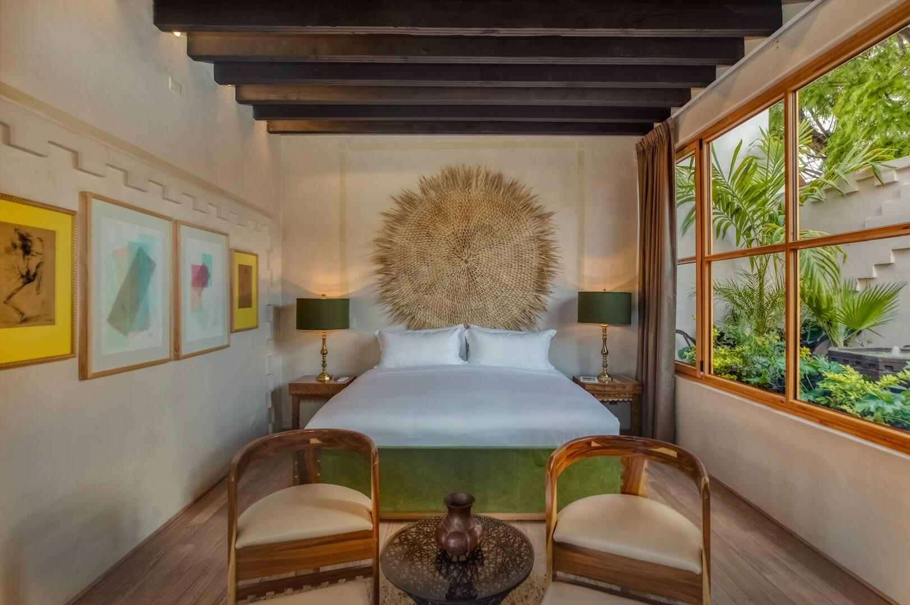

## La Valise San Miguel de Allende &nbsp;

### Introduction
Hidden behind a discreet colonial façade on a quiet cobblestone street in the historic heart of San Miguel de Allende, La Valise offers an intimate luxury boutique experience where art, architecture, and contemporary design come together. This distinctive property features just six individually designed suites, each reflecting the historical character of the building while incorporating bespoke furnishings, custom artwork, and refined contemporary details. At the heart of the hotel is a beautiful courtyard garden with tranquil swimming pools and striking works by renowned Mexican artist Pedro Friedeberg, whose surrealist aesthetic plays an important role in the property's identity. Combining the charm of a historic Mexican residence with personalised hospitality and thoughtful design, La Valise is a peaceful urban retreat for culturally curious travellers seeking something beyond a conventional luxury hotel. A member of Small Luxury Hotels of the World, the property welcomes guests aged 12 and above.

### Location
Located on Jesús 17 in the historic centre of San Miguel de Allende, La Valise enjoys an exceptional position within this UNESCO World Heritage Site. Surrounded by cobblestone streets, colourful colonial buildings, independent galleries, artisan boutiques, and charming cafés, the hotel places guests right at the heart of the city's artistic and cultural life. The main square, Jardín Allende, and the iconic Parroquia de San Miguel Arcángel are just a short walk away. Guests can explore the city's historic churches, discover its thriving art scene, visit traditional markets, or enjoy the many restaurants and rooftop terraces that make San Miguel such a celebrated destination. For those wishing to explore beyond the city, Dolores Hidalgo and Guanajuato offer excellent opportunities for cultural excursions and discovering the wider region.

### What to Do
Spend your days discovering San Miguel de Allende on foot, wandering through its picturesque streets, exploring art galleries, visiting artisan workshops, and browsing independent boutiques. Admire the impressive architecture around Jardín Allende and the iconic pink façade of the Parroquia de San Miguel Arcángel, or visit Fábrica La Aurora, a former textile factory transformed into a vibrant centre for art, design, and antiques. The concierge can curate personalised experiences through The Voyage Within programme, connecting guests with the destination through five themes: wellness, nature and adventure, culture and art, community, and gastronomy. Experiences can include private cultural excursions, creative workshops, culinary discoveries, and wellness treatments. For a more relaxing afternoon, return to the hotel to enjoy the tranquil courtyard garden, take a dip in one of the pools, or unwind in the peaceful surroundings of your suite. The hotel can also arrange private transfers and excursions to explore the neighbouring towns and countryside.

### Why We Recommend This Hotel
An intimate boutique experience – With just six individually designed suites, La Valise offers a highly personalised stay in a peaceful and private setting. &nbsp;  
&nbsp;  
A historic colonial residence – The property combines the architectural character of San Miguel's historic buildings with contemporary comfort and thoughtful design. &nbsp;  
&nbsp;  
Artistic identity and Mexican creativity – Renowned artist Pedro Friedeberg's surrealist works and distinctive aesthetic bring a unique artistic dimension to the hotel's architecture and interiors. &nbsp;  
&nbsp;  
A beautiful courtyard retreat – The lush garden, tranquil swimming pools, and inviting common areas create a peaceful oasis in the heart of the city. &nbsp;  
&nbsp;  
Individually designed suites – Each of the six suites has its own character, with bespoke furnishings, custom artwork, and carefully selected details reflecting the heritage of San Miguel. &nbsp;  
&nbsp;  
The Voyage Within experiences – A curated programme of wellness, culture, art, nature, community, and gastronomy allows guests to discover the destination through meaningful and personalised encounters. &nbsp;  
&nbsp;  
An exceptional historic-centre location – Situated within walking distance of the main square, the Parroquia, galleries, boutiques, and restaurants, the hotel is perfectly positioned for exploring the city. &nbsp;  
&nbsp;  
A personalised approach to hospitality – Dedicated concierge services, tailored recommendations, and thoughtfully arranged experiences create a stay designed around each guest's interests. &nbsp;  

### Dining Options
La Valise San Miguel does not have an on-site restaurant, instead offering a more personalised approach to dining through complimentary daily breakfast and a carefully selected collection of partner restaurants throughout the city. Breakfast provides a relaxed start to the day before heading out to explore San Miguel's culinary scene. The concierge can recommend and arrange reservations at some of the destination's most interesting dining establishments, from contemporary Mexican restaurants and traditional regional kitchens to intimate cafés and rooftop venues with views across the colonial skyline. This approach allows guests to discover the city's exceptional gastronomy while enjoying the comfort and privacy of a boutique residence. Private culinary experiences and gastronomic activities can also be arranged through The Voyage Within programme.

<iframe src="https://www.google.com/maps/embed?pb=!1m18!1m12!1m3!1d3726.9847949839423!2d-100.74733962445035!3d20.912931391745914!2m3!1f0!2f0!3f0!3m2!1i1024!2i768!4f13.1!3m3!1m2!1s0x842b512ee9de04bd%3A0x494a00884fe06f41!2sLa%20Valise%20San%20Miguel%20de%20Allende%2C%20an%20SLH%20Hotel!5e0!3m2!1sen!2sde!4v1795358465729!5m2!1sen!2sde" width="800" height="450" style="border:0;" allowfullscreen="" loading="lazy" referrerpolicy="strict-origin-when-cross-origin"></iframe>