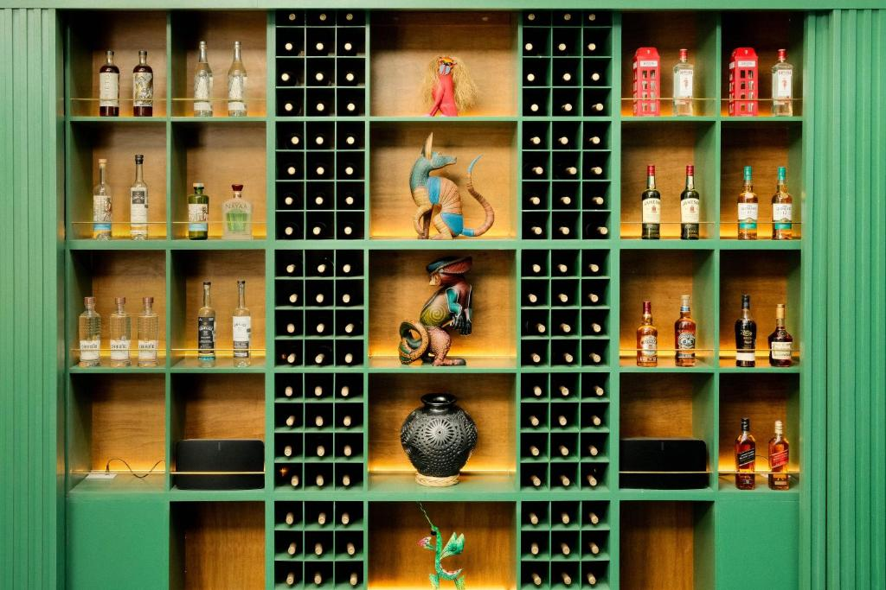
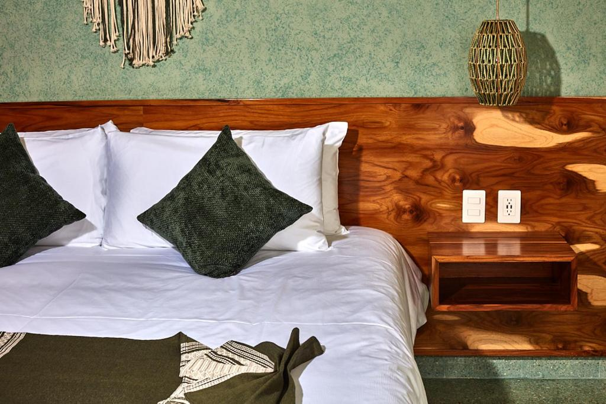
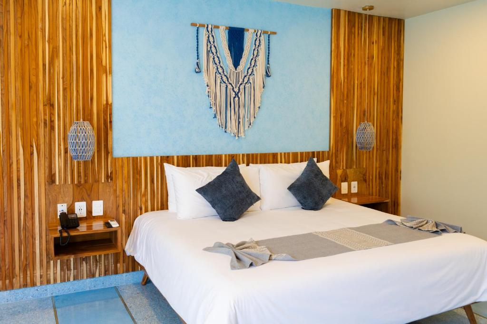
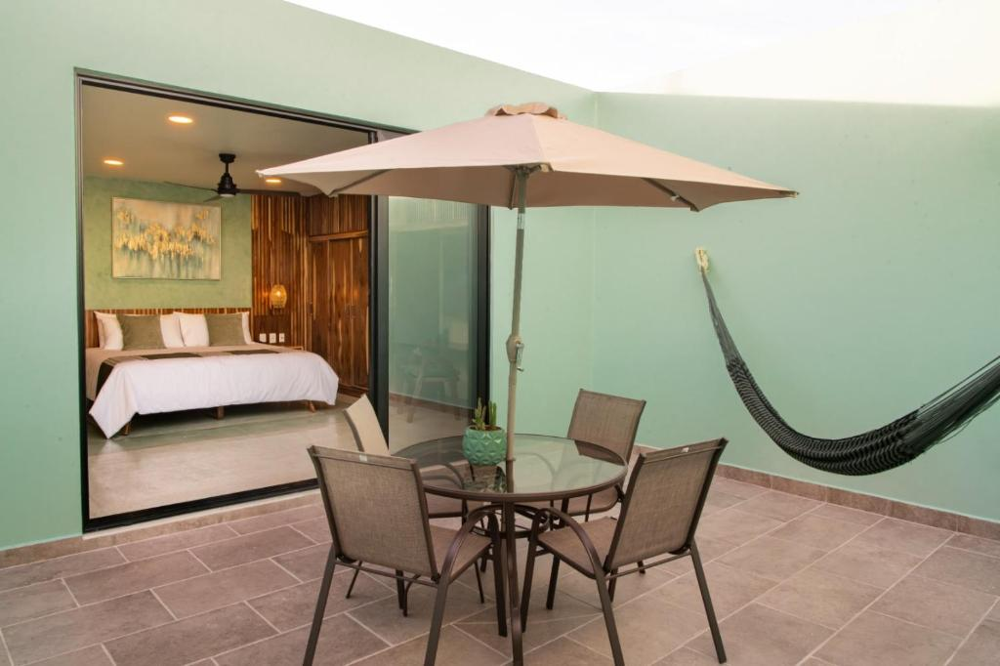

## Luuna de Jade Oaxaca &nbsp;

### Introduction
Inspired by the serenity of jade and the rich cultural heritage of Oaxaca, Luuna de Jade is an intimate boutique hotel located in the heart of the city's historic centre. Combining contemporary design with traditional regional elements, the property offers a personalised hospitality experience that celebrates the artistic identity and craftsmanship of Oaxaca. Its interiors feature carefully selected textures, natural materials, and distinctive colour palettes, creating a sense of tranquillity and understated elegance. The name Luuna derives from the Zapotec word for bed, reflecting the hotel's philosophy of making rest a meaningful experience. With its individually designed rooms, welcoming atmosphere, and connection to local culture, Luuna de Jade offers a comfortable and characterful base for discovering one of Mexico's most culturally rich destinations.

### Location
Located on José María Pino Suárez in the historic centre of Oaxaca City, Luuna de Jade enjoys a privileged position within walking distance of the destination's principal cultural, architectural, and gastronomic attractions. The surrounding streets reveal the charm of colonial Oaxaca, with colourful buildings, traditional markets, independent boutiques, artisan workshops, and contemporary art galleries. The impressive Templo de Santo Domingo, the historic Zócalo, and the city's renowned museums are easily accessible on foot. Beyond the city, Oaxaca offers extraordinary opportunities to explore its ancient Zapotec heritage, traditional villages, and spectacular natural landscapes. The archaeological site of Monte Albán, the natural formations of Hierve el Agua, and the mezcal-producing communities of the surrounding valleys are all excellent options for day excursions.

### What to Do
Discover Oaxaca's historic centre on foot, exploring its beautiful colonial streets, traditional markets, museums, and art galleries. Visit the impressive Templo de Santo Domingo and its cultural centre, or enjoy a gastronomic tour to discover the region's celebrated culinary traditions. For a deeper understanding of the area's history, arrange a guided visit to Monte Albán, the ancient Zapotec city overlooking the Oaxaca Valley. Nature lovers can explore Hierve el Agua, famous for its spectacular petrified waterfalls, natural pools, and panoramic mountain views. The surrounding valleys also offer opportunities to discover traditional mezcal production through visits to artisanal palenques, where guests can learn about the production process and enjoy guided tastings. For a more immersive cultural experience, cooking workshops and tastings of regional specialities such as mole, tlayudas, and artisanal chocolate can also be arranged. The hotel's concierge team can coordinate personalised excursions and experiences tailored to individual interests.

### Why We Recommend This Hotel
A central historic location – Situated in the heart of Oaxaca's historic centre, the hotel provides an excellent base for exploring the city's cultural attractions, markets, galleries, and restaurants on foot. &nbsp;  
&nbsp;  
Inspired by local heritage – The hotel's concept draws inspiration from the Zapotec language and the symbolism of jade, creating a distinctive identity connected to the cultural traditions of Oaxaca. &nbsp;  
&nbsp;  
Contemporary design with regional character – Carefully selected colours, handcrafted textures, and traditional decorative elements create an atmosphere that combines modern comfort with local influences. &nbsp;  
&nbsp;  
Individually designed accommodation – From Deluxe Rooms to spacious Junior and Master Suites with private terraces and living areas, the rooms offer different options for a comfortable and personalised stay. &nbsp;  
&nbsp;  
A distinctive culinary experience – Mantis Cocktail Bar & Restaurant combines international cuisine, contemporary techniques, regional ingredients, and a carefully curated selection of Mexican mezcals. &nbsp;  
&nbsp;  
Curated cultural experiences – The concierge can arrange visits to Monte Albán, Hierve el Agua, traditional mezcal producers, and local culinary workshops, allowing guests to discover the region beyond the city. &nbsp;  
&nbsp;  
An artistic connection to Oaxaca – The hotel's gallery hosts temporary exhibitions by notable Oaxacan artists, celebrating the region's creativity and offering guests the opportunity to discover and acquire local artworks. &nbsp;  

### Dining Options
Mantis Cocktail Bar & Restaurant is the hotel's main gastronomic destination, bringing together international cuisine, contemporary culinary techniques, and ingredients sourced from the Oaxaca region. Its approach celebrates the richness of local flavours while introducing a modern interpretation of regional gastronomy. The menu includes vegetarian options and dishes prepared with creativity and attention to detail. In the morning, guests can enjoy an à la carte breakfast, freshly prepared to order. The cocktail offering combines classic creations with a carefully selected collection of exceptional mezcals, chosen in collaboration with local producers to highlight the character and diversity of Oaxaca's traditional spirits. Open daily from 8:00 AM to 11:00 PM, Mantis welcomes both hotel guests and external visitors, making it an inviting destination throughout the day.

<iframe src="https://www.google.com/maps/embed?pb=!1m18!1m12!1m3!1d3814.1842027362186!2d-96.72268832452201!3d17.063640212050124!2m3!1f0!2f0!3f0!3m2!1i1024!2i768!4f13.1!3m3!1m2!1s0x85c723007fdd8c3b%3A0x2df103d9dd9167a5!2sLuuna%20de%20Jade%20-%20Hotel%20Boutique!5e0!3m2!1sen!2sde!4v1795360550468!5m2!1sen!2sde" width="800" height="450" style="border:0;" allowfullscreen="" loading="lazy" referrerpolicy="strict-origin-when-cross-origin"></iframe>