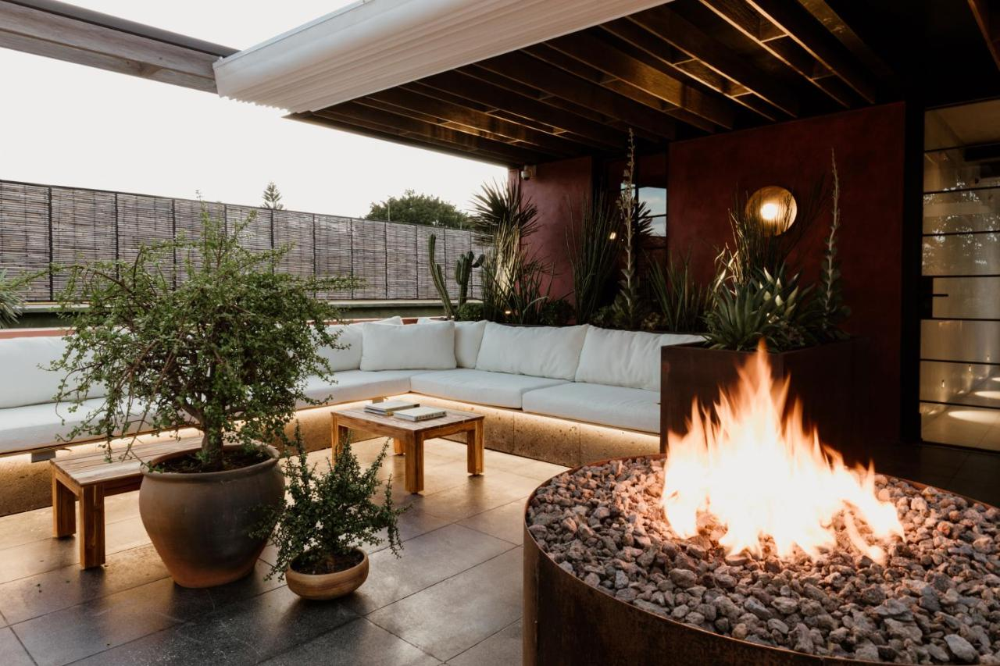
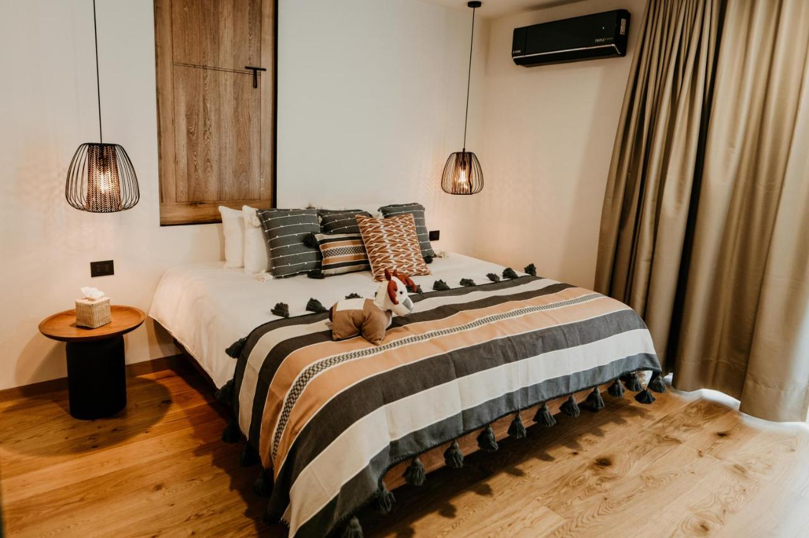
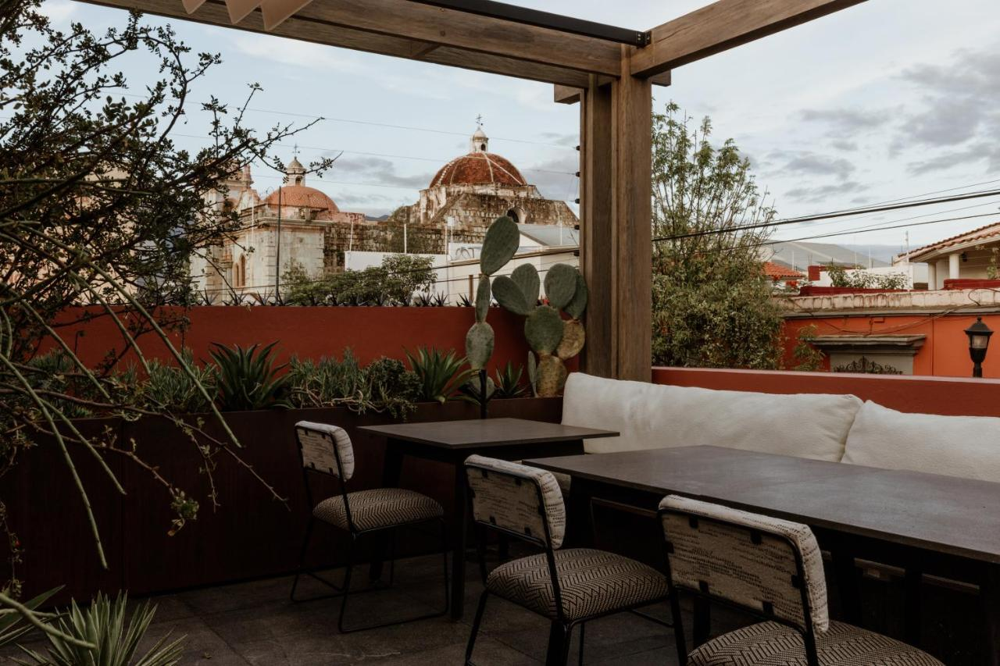

## Majagua Hotel Boutique Oaxaca &nbsp;

### Introduction
Located in the heart of Oaxaca's historic centre, Majagua Hotel Boutique is an intimate adults-only retreat that combines contemporary sophistication with the rich cultural heritage of the region. Set within a beautifully restored historic mansion, the property brings together architectural character, Oaxacan craftsmanship, and an eclectic interior design inspired by different cultures. With just 14 individually designed rooms, the hotel offers a relaxed and personalised atmosphere, providing a peaceful sanctuary after a day discovering the colourful streets, artistic traditions, and culinary treasures of Oaxaca. Natural textures, handcrafted amenities, and carefully selected decorative details create a distinctive sense of place, while modern comforts ensure a relaxing stay. Majagua is an excellent choice for travellers seeking an intimate boutique experience with a strong connection to the destination.

### Location
Situated on José María Pino Suárez in the historic centre of Oaxaca City, Majagua enjoys an excellent location within walking distance of the city's principal cultural and architectural attractions. The surrounding streets are filled with colourful colonial buildings, traditional markets, artisan shops, independent galleries, and some of the region's most celebrated restaurants. The magnificent Santo Domingo de Guzmán Church, the Zócalo, and the lively Mercado 20 de Noviembre are all easily accessible on foot. The hotel is also well positioned for discovering Oaxaca's wider cultural heritage, with opportunities to explore the ancient Zapotec archaeological site of Monte Albán, the spectacular natural formations of Hierve el Agua, and the traditional villages renowned for their crafts and culinary traditions. Oaxaca International Airport is approximately 8 kilometres from the property.

### What to Do
Discover Oaxaca on foot, exploring its colourful streets, historic architecture, art galleries, and traditional markets. Visit the impressive Santo Domingo de Guzmán Church and the adjoining cultural centre, browse the artisan stalls at Mercado Benito Juárez, or experience the flavours and aromas of Mercado 20 de Noviembre. Art and culture enthusiasts can discover the Museo de las Culturas de Oaxaca and the Museo de Arte Prehispánico Rufino Tamayo. Beyond the city, arrange an excursion to Monte Albán to explore one of the most important archaeological sites of the ancient Zapotec civilisation, or visit the natural mineral formations of Hierve el Agua. The surrounding valleys are also home to traditional artisan communities, including villages specialising in textiles, pottery, and alebrijes. After a day of exploration, return to Majagua to enjoy the hotel's peaceful atmosphere or discover the culinary offering at Endémico Restaurante.

### Why We Recommend This Hotel
An intimate boutique experience – With only 14 individually designed rooms, Majagua offers a personalised atmosphere and a peaceful retreat in the heart of Oaxaca. &nbsp;  
&nbsp;  
A strong connection to local culture – The hotel's design combines Oaxacan influences, handcrafted details, and decorative elements inspired by different cultures, creating a distinctive sense of place. &nbsp;  
&nbsp;  
An adults-only sanctuary – The property offers a tranquil environment exclusively for adult guests, ideal for couples and travellers seeking a relaxed city escape. &nbsp;  
&nbsp;  
Individually designed accommodation – From rooms with private patios to the spacious Signature Suite, each category offers its own personality, combining natural textures, local details, and contemporary comfort. &nbsp;  
&nbsp;  
A central historic location – Situated within walking distance of Oaxaca's principal attractions, traditional markets, museums, galleries, and restaurants, the hotel is an excellent base for discovering the city. &nbsp;  
&nbsp;  
A taste of Oaxaca – Endémico Restaurante celebrates the region's culinary traditions through local flavours combined with Mediterranean and Oriental influences. &nbsp;  
&nbsp;  
Thoughtful hospitality – A welcome cocktail, continental breakfast, and personalised attention contribute to a comfortable and welcoming stay. &nbsp;  

### Dining Options
Endémico Restaurante is the hotel's culinary highlight, offering a creative interpretation of Oaxacan cuisine through a combination of local ingredients and Mediterranean and Oriental influences. The menu celebrates the rich diversity of regional flavours, bringing together traditional ingredients and contemporary culinary techniques to create a distinctive gastronomic experience. The restaurant provides an inviting setting in which to discover the culinary identity of Oaxaca, complemented by a relaxed atmosphere and a terrace where guests can enjoy drinks and regional specialities. Continental breakfast is included with the stay, providing a convenient start to the day before heading out to explore the city's celebrated food markets, traditional kitchens, and contemporary restaurants. 

<iframe src="https://www.google.com/maps/embed?pb=!1m18!1m12!1m3!1d3814.127007160386!2d-96.72211992452192!3d17.066439111970908!2m3!1f0!2f0!3f0!3m2!1i1024!2i768!4f13.1!3m3!1m2!1s0x85c72398bb9cf005%3A0xa8f19986f609480a!2sMajagua%20Hotel%20Boutique%20Oaxaca.!5e0!3m2!1sen!2sde!4v1795360248168!5m2!1sen!2sde" width="800" height="450" style="border:0;" allowfullscreen="" loading="lazy" referrerpolicy="strict-origin-when-cross-origin"></iframe>