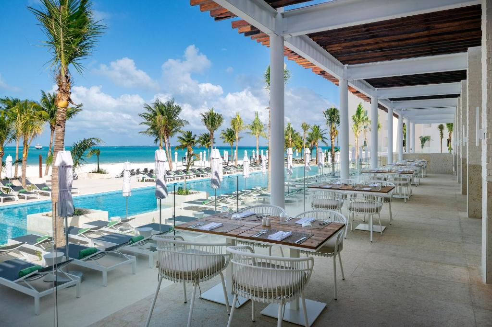
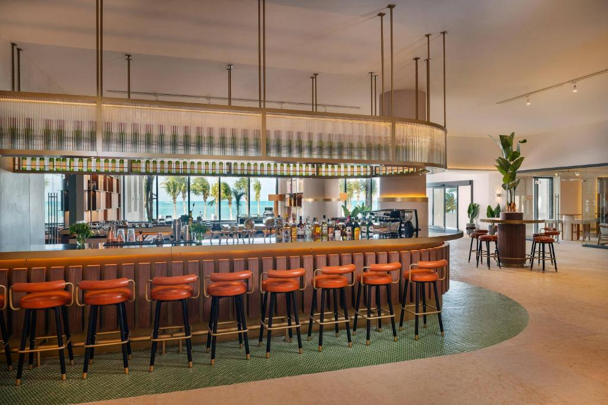
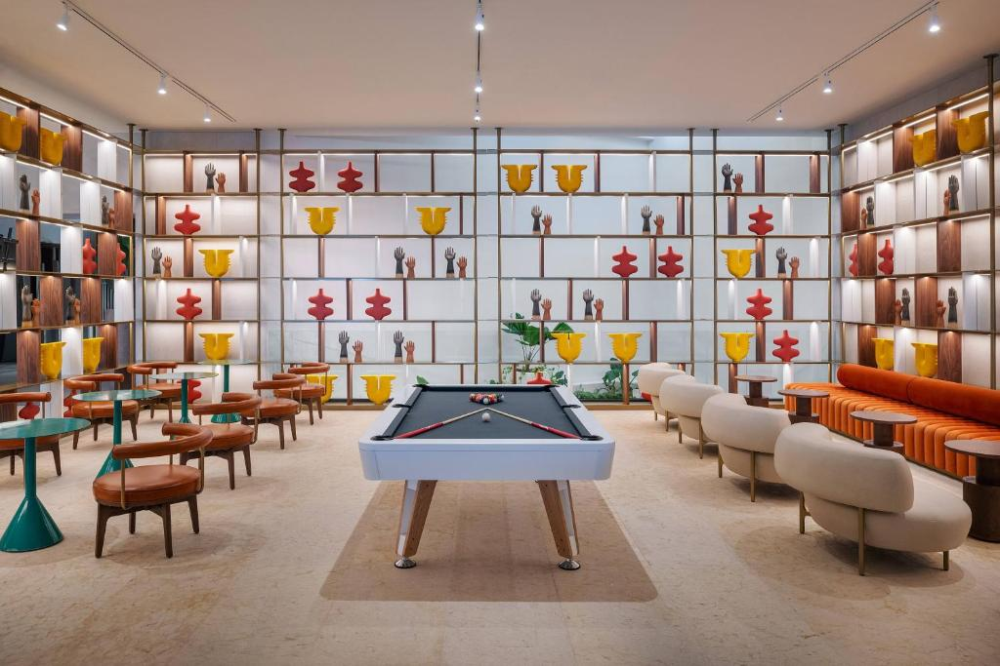
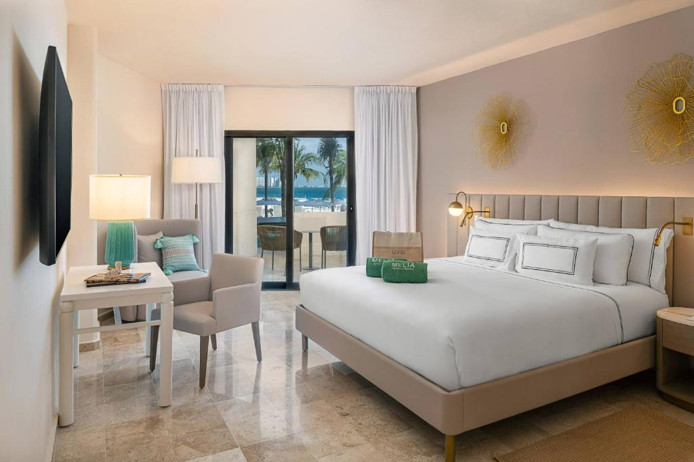

## Meliá Casa Maya Cancún &nbsp;

### Introduction
Inspired by the rich heritage and traditions of the ancient Mayan civilisation, Meliá Casa Maya Cancún is a beachfront all-inclusive resort that combines the beauty of the Mexican Caribbean with a welcoming atmosphere for families and travellers of all ages. Located along the shores of Cancún's Hotel Zone, the resort offers contemporary rooms and spacious suites, many with spectacular ocean views, alongside swimming pools, a dedicated water park, and a variety of dining and entertainment experiences. Its connection to local culture is reflected in its design, culinary offering, and cultural activities, creating a holiday experience that brings together relaxation, family fun, and a sense of place. For guests seeking an elevated stay, The Level offers additional privileges, exclusive areas, and personalised attention.

### Location
Situated on Boulevard Kukulcán, at kilometre 5.5 of Cancún's Hotel Zone, Meliá Casa Maya enjoys a beachfront position overlooking the turquoise waters of the Caribbean Sea. Its location offers a convenient balance between the resort's relaxed atmosphere and access to Cancún's wider attractions. The city centre is approximately 6 kilometres away, while Cancún International Airport is around 22 kilometres from the property. Guests can explore the area's shopping and entertainment venues, discover the region's archaeological heritage, or arrange excursions to nearby islands and natural attractions. The resort also provides a convenient starting point for exploring the wider Riviera Maya and the cultural treasures of the Yucatán Peninsula.

### What to Do
Enjoy the Caribbean sunshine beside the resort's outdoor swimming pools or spend the day at the beach, with direct access to the sea. Families can make the most of Splash Island, the hotel's water park featuring slides and interactive water attractions, while younger guests can enjoy dedicated activities, creative workshops, and outdoor adventures through the children's programme. The entertainment offering also celebrates the region's heritage, with pre-Hispanic Mayan performances, live Latin music, DJ sessions, and themed evenings. For a more relaxing experience, visit YHI Spa for restorative treatments and wellness rituals, or maintain your fitness routine at the hotel's gym. Beyond the resort, explore Cancún's attractions or arrange excursions to discover the archaeological sites, cenotes, and natural landscapes of the Yucatán Peninsula.

### Why We Recommend This Hotel
A beachfront Caribbean setting – Direct access to the beach and beautiful views of the turquoise Caribbean Sea create an inviting setting for a relaxed Cancún holiday. &nbsp;  
&nbsp;  
A family-friendly all-inclusive experience – A wide selection of dining, drinks, activities, and entertainment makes the resort an easy and convenient choice for families. &nbsp;  
&nbsp;  
Splash Island water park – Dedicated water slides and interactive attractions provide hours of entertainment for younger guests and families. &nbsp;  
&nbsp;  
A connection to Mayan culture – Inspired by the heritage of the region, the resort incorporates cultural experiences, including traditional performances and themed entertainment. &nbsp;  
&nbsp;  
The Level experience – Guests choosing The Level enjoy additional privileges, including private areas, a dedicated lounge, exclusive breakfast arrangements, and personalised attention. &nbsp;  
&nbsp;  
A variety of accommodation options – From ocean-view rooms to spacious suites and swim-up categories, the resort offers different options to suit couples and families. &nbsp;  
&nbsp;  
Wellness and relaxation – YHI Spa, swimming pools, and a fully equipped fitness centre provide opportunities to unwind and recharge throughout the stay. &nbsp;  

### Dining Options
Meliá Casa Maya offers a varied culinary experience across several restaurants and bars, with dining included as part of the all-inclusive concept. Merkado is the resort's buffet restaurant, serving breakfast, lunch, and dinner with a selection of local Mexican specialities and international favourites. For a more relaxed seaside setting, Cape Nao offers international cuisine accompanied by beautiful ocean views and the Caribbean breeze. Casa Nostra provides an Italian dining experience, with refined dishes prepared using fresh ingredients and authentic flavours. For drinks and cocktails, Boreal Lobby Bar offers an elegant and comfortable setting in which to unwind. Together, the restaurants and bars provide a range of options throughout the day, combining international favourites with flavours inspired by the region.

<iframe src="https://www.google.com/maps/embed?pb=!1m18!1m12!1m3!1d68690.60196846284!2d-86.7730692076449!3d21.135145391564965!2m3!1f0!2f0!3f0!3m2!1i1024!2i768!4f13.1!3m3!1m2!1s0x8f4c28be2be185db%3A0x919068539adfb1da!2sMeli%C3%A1%20Casa%20Maya%20Canc%C3%BAn!5e0!3m2!1sen!2sde!4v1794742197763!5m2!1sen!2sde" width="800" height="450" style="border:0;" allowfullscreen="" loading="lazy" referrerpolicy="strict-origin-when-cross-origin"></iframe>