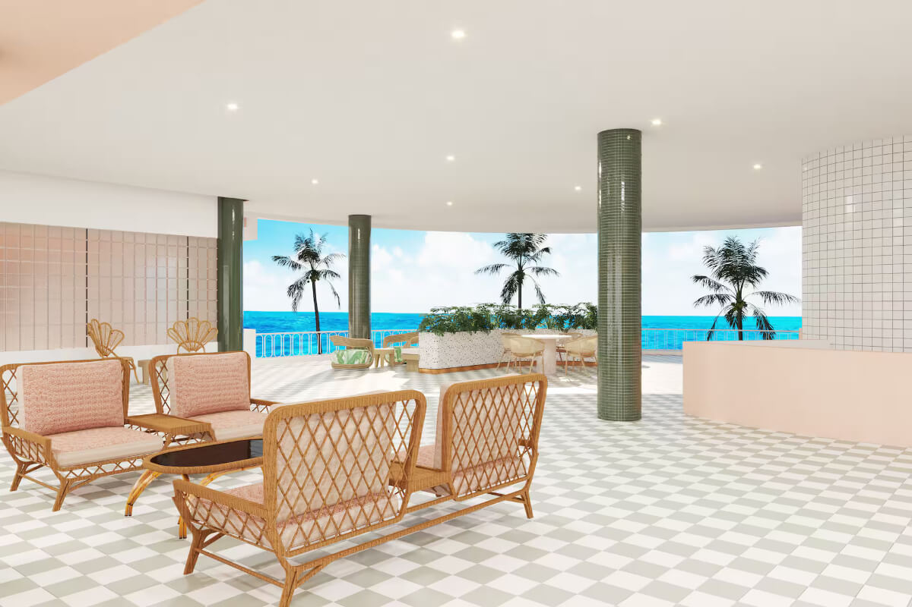

## Perla La Paz, Tapestry Collection by Hilton &nbsp;

### Introduction
An iconic landmark in the heart of La Paz, Perla La Paz, Tapestry Collection by Hilton brings a new chapter to one of the city's most recognisable hotels. Set along the picturesque Malecón overlooking the Sea of Cortez, the property blends the spirit of its 1940s Art Deco heritage with contemporary design and the relaxed sophistication of Baja California Sur. Featuring 90 rooms, the hotel offers an inviting combination of historic character, modern comfort, and a strong connection to its coastal surroundings. Guests can enjoy a rooftop restaurant with spectacular views, distinctive culinary experiences, an outdoor swimming pool, and wellness facilities, all within walking distance of the city's lively waterfront and historic centre. As part of Hilton's Tapestry Collection, Perla offers a stay with a distinctive local identity and a sense of place.

### Location
Located on Paseo Álvaro Obregón, directly along La Paz's iconic Malecón, Perla La Paz enjoys a privileged position overlooking the Sea of Cortez. The waterfront promenade is ideal for leisurely walks, cycling, enjoying the sunset, and discovering the city's cafés, restaurants, and local atmosphere. The historic centre is within walking distance, offering access to cultural attractions, independent shops, and the Baja California Sur Regional Museum. La Paz is also an excellent gateway to the natural wonders of the region, including the beautiful beaches of Balandra and Tecolote, the islands of the Sea of Cortez, and the extraordinary marine life that makes this part of Mexico one of the country's most appealing destinations for nature and ocean enthusiasts.

### What to Do
Enjoy a relaxed morning exploring the Malecón, taking in the spectacular views across the Sea of Cortez, or unwind beside the hotel's outdoor swimming pool. Discover the historic streets of La Paz, browse local boutiques, and experience the city's relaxed dining and café culture. The surrounding waters offer exceptional opportunities for marine adventures, from kayaking and paddleboarding to snorkelling and boat excursions. Arrange a day trip to Balandra Beach, famous for its shallow turquoise waters and spectacular desert scenery, or explore Espíritu Santo Island, a protected natural paradise known for its marine wildlife and opportunities to encounter sea lions. Back at the hotel, enjoy a sunset cocktail at the rooftop bar, indulge in a spa treatment, or relax after a day discovering the natural beauty of Baja California Sur.

### Why We Recommend This Hotel
An iconic La Paz address – Set along the city's famous Malecón, the hotel combines a central waterfront location with beautiful views of the Sea of Cortez. &nbsp;  
&nbsp;  
A distinctive Art Deco heritage – The property's 1940s origins are reflected in its character, blending historic inspiration with contemporary design and the relaxed atmosphere of Baja California Sur. &nbsp;  
&nbsp;  
A strong sense of place – As part of Tapestry Collection by Hilton, Perla celebrates the local identity and character of its destination rather than offering a conventional international hotel experience. &nbsp;  
&nbsp;  
Rooftop dining and sunsets – El Faro Paceño Rooftop provides an inviting setting for enjoying food and drinks while taking in the surrounding views. &nbsp;  
&nbsp;  
A celebration of local gastronomy – The hotel's restaurants highlight Mexican cuisine and ingredients from the Sea of Cortez, with seafood playing an important role in the culinary offering. &nbsp;  
&nbsp;  
A relaxing urban retreat – An outdoor swimming pool, spa, and fitness centre provide opportunities to unwind and recharge during your stay. &nbsp;  
&nbsp;  
An excellent base for nature experiences – Its location makes it easy to discover La Paz's beautiful beaches, protected islands, and extraordinary marine environment. &nbsp;  

### Dining Options
Perla La Paz offers several distinct dining experiences, celebrating Mexican cuisine, local ingredients, and the flavours of the Sea of Cortez. Perla Restaurante, the hotel's main restaurant, focuses on regional seafood and Mexican specialities, with a menu featuring ceviches, fresh fish, grilled seafood, and zarandeado-style fish, complemented by an extensive wine cellar with selections from both the Old and New World. La Terraza Restaurant pays tribute to the hotel's heritage through an interpretation of authentic Mexican cuisine, offering an experience that can be enjoyed throughout the day. For a more relaxed atmosphere, Bar Balandra is located in the hotel's central courtyard and follows a healthy dining concept, providing an inviting setting for drinks and light refreshments. El Faro Paceño Rooftop offers a more elevated experience, combining comfort-focused cuisine with beautiful views of La Paz and the surrounding coastline. Together, these venues create a varied culinary offering that connects the hotel's identity with the gastronomic traditions of Baja California Sur.

<iframe src="https://www.google.com/maps/embed?pb=!1m18!1m12!1m3!1d3640.2719545629297!2d-110.32034998871197!3d24.162193372752025!2m3!1f0!2f0!3f0!3m2!1i1024!2i768!4f13.1!3m3!1m2!1s0x86afd35fbc6229fb%3A0x2dd4d22a6b2ab60b!2sPerla%20La%20Paz%2C%20Tapestry%20Collection%20by%20Hilton!5e0!3m2!1sen!2sde!4v1794744873867!5m2!1sen!2sde" width="800" height="450" style="border:0;" allowfullscreen="" loading="lazy" referrerpolicy="strict-origin-when-cross-origin"></iframe>