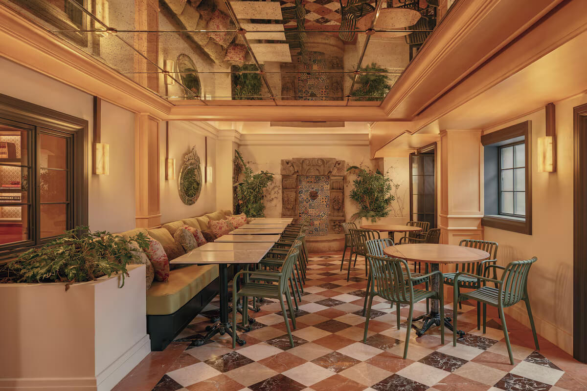
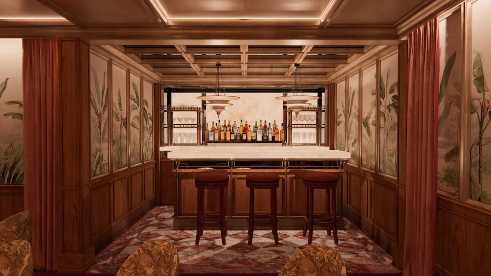
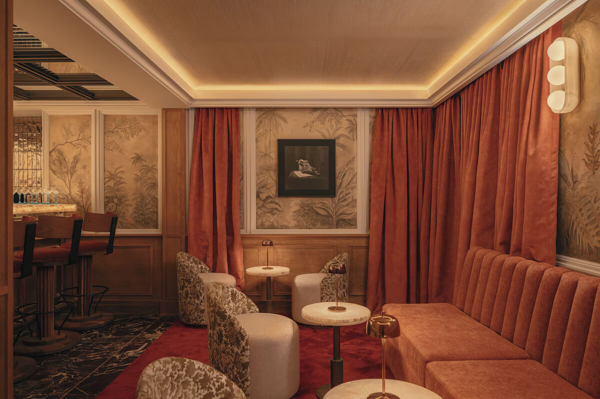
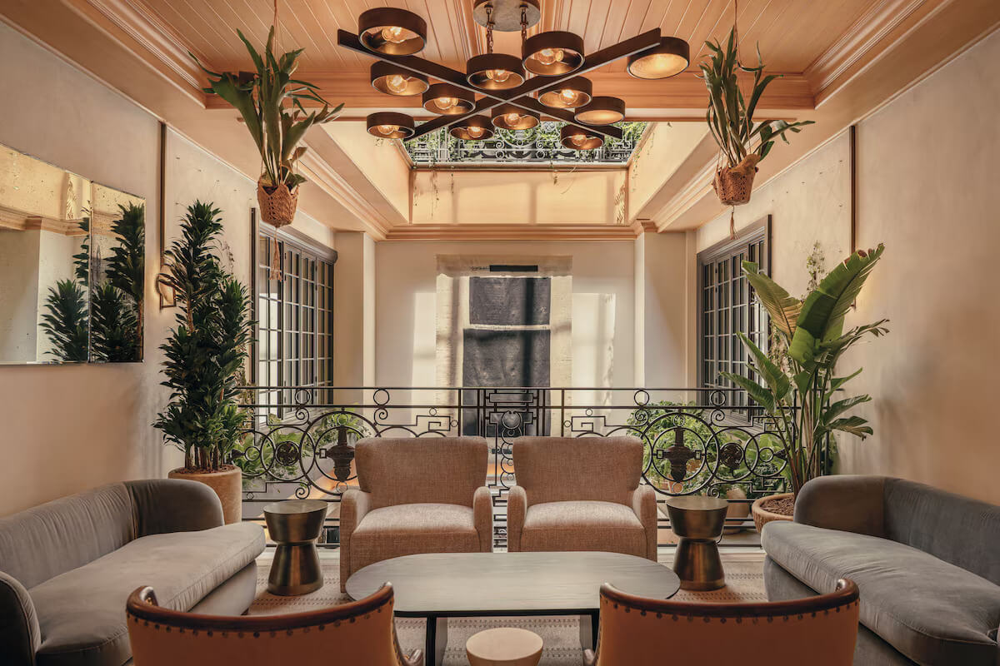
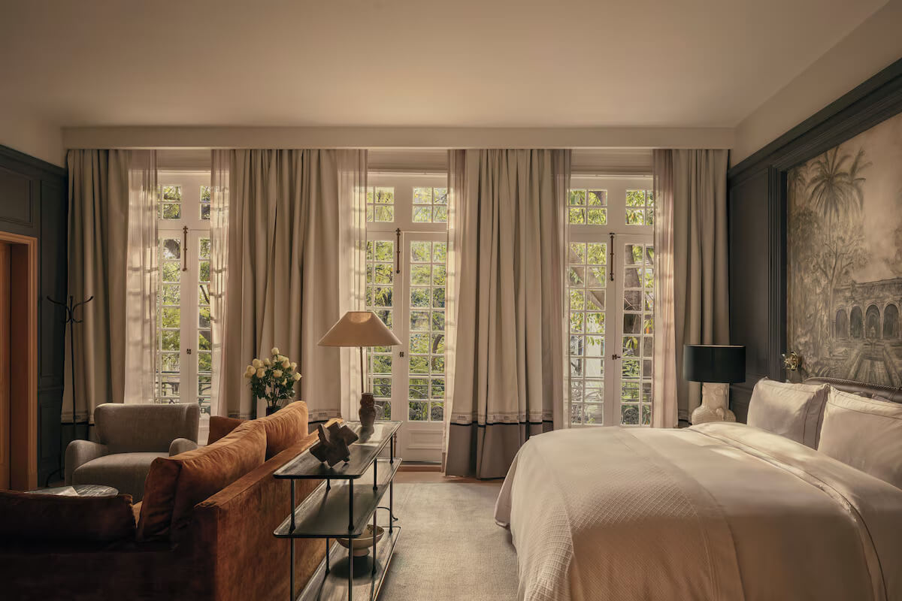

## Sara y Julieta Mexico City &nbsp;

### Introduction
Set within two beautifully restored Porfirian residences dating back to the early 20th century, Sara y Julieta is an intimate luxury boutique hotel in the heart of Mexico City's vibrant Roma Norte neighbourhood. Inspired by two remarkable women connected to the area's history, Sara Pérez de Madero and Julieta Bastard, the property celebrates individuality, creativity, and the cultural heritage of the neighbourhood. Designed by HOST Architecture & Design, the hotel combines elegant French-inspired architecture with contemporary interiors, refined Mexican craftsmanship, and carefully curated details. With just 22 individually designed rooms and suites, distinctive culinary concepts, and an intimate wellness sanctuary, Sara y Julieta offers a sophisticated urban retreat that feels both deeply connected to its surroundings and wonderfully private. A member of The Leading Hotels of the World, it brings a distinctive new perspective to luxury hospitality in Mexico City.

### Location
Located on Tonalá Street in Roma Norte, Sara y Julieta enjoys a prime position in one of Mexico City's most fashionable and culturally vibrant neighbourhoods. The surrounding streets are filled with independent boutiques, contemporary art galleries, design studios, cafés, and some of the city's most celebrated restaurants. Parque México and the neighbouring Condesa district are approximately a 10-minute walk away, offering beautiful tree-lined avenues, elegant architecture, and a lively café culture. Paseo de la Reforma, Polanco, and the historic city centre are also easily accessible, making the hotel an excellent base for discovering the capital's cultural landmarks, shopping destinations, and gastronomic scene.

### What to Do
Discover Roma Norte through the hotel's curated neighbourhood itineraries, designed to reveal the area's artistic, architectural, and literary heritage. Explore independent galleries, concept stores, vintage boutiques, and the neighbourhood's celebrated culinary scene, or take a leisurely walk towards Condesa and Parque México. Art enthusiasts can discover the nearby galleries and cultural institutions before venturing further into the city to visit the Museo Nacional de Antropología, Museo de Arte Moderno, or the historic centre. Back at the hotel, enjoy a personalised wellness experience at the boutique spa, featuring a thermal circuit with sauna and cold plunge, lymphatic treatments, and herbal remedies. The Technogym-equipped fitness centre offers further opportunities to maintain your routine. In the evening, experience the hotel's distinctive dining and cocktail concepts, from fine dining at Pérez to the intimate atmosphere of Bastard, or discover the rooftop omakase experience.

### Why We Recommend This Hotel
A distinctive historic setting – Housed within two beautifully restored Porfirian residences dating from 1903 to 1911, the hotel combines architectural heritage with contemporary luxury. &nbsp;  
&nbsp;  
An intimate boutique experience – With only 22 rooms and suites, Sara y Julieta offers a personalised atmosphere and a sense of privacy in the heart of the city. &nbsp;  
&nbsp;  
A celebration of Mexican design – Contemporary interiors, refined craftsmanship, marble finishes, and carefully selected artworks create a sophisticated aesthetic rooted in local culture. &nbsp;  
&nbsp;  
Individually designed accommodation – From intimate Alcoba rooms to spacious suites, each category offers its own character, with selected rooms featuring balconies and Mirador Suites offering private rooftop terraces. &nbsp;  
&nbsp;  
A remarkable culinary offering – Pérez, the speakeasy-style Bastard cocktail bar, and the rooftop omakase experience create a distinctive gastronomic destination within the hotel. &nbsp;  
&nbsp;  
A dedicated wellness sanctuary – The boutique spa features a thermal circuit with sauna and cold plunge, alongside specialised treatments and a Technogym fitness centre. &nbsp;  
&nbsp;  
An excellent Roma Norte location – Surrounded by galleries, independent boutiques, cafés, and celebrated restaurants, the hotel places guests within walking distance of some of Mexico City's most interesting neighbourhood experiences. &nbsp;  

### Dining Options
Sara y Julieta offers a distinctive collection of culinary experiences that reflect the creativity and cultural character of Roma Norte. Pérez, the hotel's signature ground-floor restaurant, presents fine dining with Mexican roots, celebrating local ingredients and culinary traditions through a contemporary approach. For an intimate evening experience, Bastard is a discreet, speakeasy-style cocktail bar inspired by the bohemian spirit of the neighbourhood and named after Julieta Bastard, one of the women who inspired the hotel. The rooftop omakase venue offers another distinctive experience, focusing on an intimate and carefully crafted Japanese dining concept. In the morning, guests can enjoy a light breakfast of coffee, tea, pastries, and yoghurt in The Living Room, an exclusive guest lounge with a small patio that also serves as a relaxed space to work or connect with the concierge team. Together, these venues create a varied and characterful dining experience that extends beyond the traditional hotel restaurant concept.

<iframe src="https://www.google.com/maps/embed?pb=!1m18!1m12!1m3!1d3762.831252163478!2d-99.16545932448038!3d19.41969574109219!2m3!1f0!2f0!3f0!3m2!1i1024!2i768!4f13.1!3m3!1m2!1s0x85d1ff2de0777bd5%3A0x68b22efc946ae7b3!2sSara%20y%20Julieta!5e0!3m2!1sen!2sde!4v1795355772705!5m2!1sen!2sde" width="600" height="450" style="border:0;" allowfullscreen="" loading="lazy" referrerpolicy="strict-origin-when-cross-origin"></iframe>