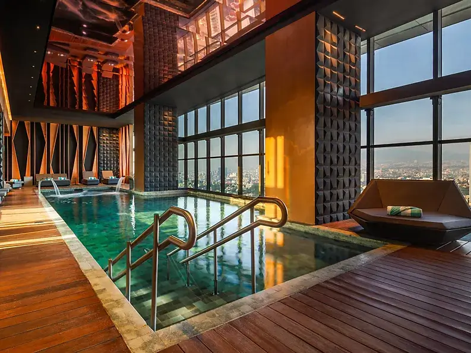
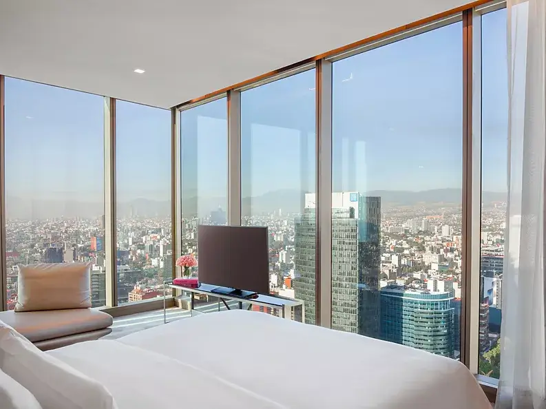
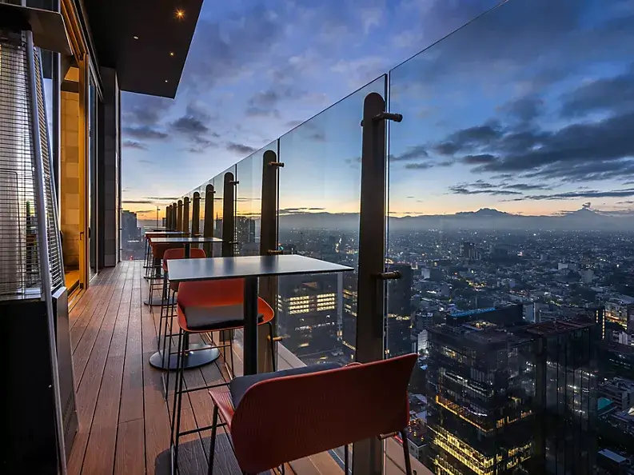
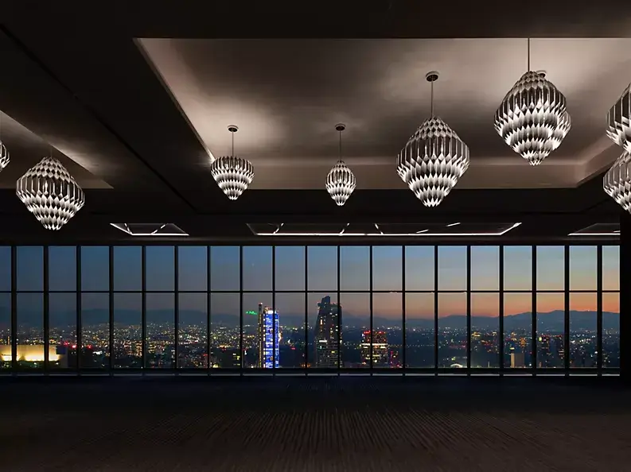

## Sofitel Mexico City Reforma &nbsp;

### Introduction
Rising above the iconic Paseo de la Reforma, Sofitel Mexico City Reforma brings together contemporary French elegance and the vibrant cultural spirit of Mexico's capital. Located in one of the city's most prestigious districts, this five-star hotel features 275 beautifully appointed rooms and suites, many offering spectacular views across the city skyline and its most recognisable landmarks. The interiors blend refined French design with Mexican influences, creating a sophisticated atmosphere throughout the property. Recognised with a MICHELIN Key, the hotel offers an exceptional combination of personalised hospitality, distinctive culinary experiences, and elevated wellness facilities, making it an excellent choice for both leisure and business travellers seeking a luxurious city stay.

### Location
Situated on Paseo de la Reforma, one of Mexico City's most celebrated avenues, Sofitel Mexico City Reforma enjoys a prime location just steps from the iconic Angel of Independence. The surrounding area is home to elegant architecture, museums, galleries, boutiques, and some of the capital's finest restaurants. Chapultepec Park and its famous castle are within easy reach, while the historic city centre, including the impressive Zócalo and Palacio de Bellas Artes, can be explored with a short journey. The nearby neighbourhoods of Roma Norte, Condesa, and Polanco offer further opportunities to discover the city's creative atmosphere, contemporary dining scene, and sophisticated shopping destinations.

### What to Do
Discover Mexico City from one of its most iconic addresses, beginning with a stroll along Paseo de la Reforma and a visit to the Angel of Independence. Explore the museums and green spaces of Chapultepec Park, including the impressive National Museum of Anthropology and Chapultepec Castle, or venture into the historic centre to admire its colonial architecture and cultural landmarks. After a day of exploring, return to the hotel to enjoy its elevated wellness facilities. The heated indoor saltwater swimming pool on the 38th floor offers a relaxing retreat with panoramic city views, while Sofitel Spa with L'Occitane provides a selection of massages and revitalising treatments. Guests can also maintain their fitness routine at the hotel's Technogym-equipped fitness centre or enjoy cocktails overlooking the skyline at Cityzen Rooftop Bar. The concierge can assist with arranging cultural experiences, private excursions, and restaurant reservations throughout the city.

### Why We Recommend This Hotel
An iconic Paseo de la Reforma address – Located just steps from the Angel of Independence, the hotel offers an exceptional base for discovering Mexico City's cultural attractions, shopping, and dining scene. &nbsp;  
&nbsp;  
French elegance meets Mexican character – Contemporary French design is complemented by local influences, creating a sophisticated atmosphere that reflects the spirit of the destination. &nbsp;  
&nbsp;  
Panoramic city views – From the guest rooms to the hotel's restaurants, bars, and wellness facilities, impressive views of the Mexico City skyline are a defining feature of the experience. &nbsp;  
&nbsp;  
Exceptional culinary experiences – With several distinctive restaurants and bars, including Michelin Guide-recognised Bajel and the spectacular Cityzen Rooftop Bar, dining is an important part of the stay. &nbsp;  
&nbsp;  
A rooftop wellness retreat – The heated indoor saltwater swimming pool and fitness centre on the 38th floor provide an impressive setting for relaxation and exercise above the city. &nbsp;  
&nbsp;  
Sofitel Spa with L'Occitane – A dedicated wellness sanctuary offering signature massages, revitalising treatments, and holistic rituals inspired by the French art of well-being. &nbsp;  
&nbsp;  
A recognised luxury experience – Awarded a MICHELIN Key and holding Green Key certification, the hotel combines high standards of hospitality with a commitment to more sustainable practices. &nbsp;  

### Dining Options
Sofitel Mexico City Reforma offers an impressive collection of restaurants and bars, bringing together French savoir-faire, Mexican flavours, and international culinary influences. Bajel is the hotel's signature gastronomic restaurant, featuring an open kitchen and a creative approach to Mexican cuisine, combining local and seasonal ingredients with international techniques and innovative mixology. Balta offers all-day dining inspired by the Mediterranean and Mexican coasts, with bold flavours and dishes prepared over wood-fired grills. For a more elevated rooftop experience, Cityzen Rooftop Bar serves contemporary cuisine and signature cocktails against spectacular panoramic views of Paseo de la Reforma, the Angel of Independence, and Chapultepec Castle. L'Obsidian provides a sophisticated cocktail destination with refined bites, curated DJ sessions, and an atmospheric evening setting. Guests can also discover Freehouse, a characterful bar specialising in wines, spirits, and classic cocktails, or experience Dans le Noir ?, an unusual dining concept in which guests enjoy their meal in complete darkness, guided by visually impaired staff. The hotel's signature Haute Croissanterie, featuring handcrafted French pastries reimagined with seasonal Mexican flavours, adds another distinctive touch to the culinary offering.

<iframe src="https://www.google.com/maps/embed?pb=!1m18!1m12!1m3!1d3762.6286678608285!2d-99.16889968881249!3d19.42844374073737!2m3!1f0!2f0!3f0!3m2!1i1024!2i768!4f13.1!3m3!1m2!1s0x85d1ff35a69a6f57%3A0x756ccccc9245591e!2sSofitel%20Mexico%20City%20Reforma!5e0!3m2!1sen!2sde!4v1794743743059!5m2!1sen!2sde" width="800" height="450" style="border:0;" allowfullscreen="" loading="lazy" referrerpolicy="strict-origin-when-cross-origin"></iframe>